> 同一个网站兼容不同的大小的设备。如PC端、移动端（平板、横 屏、竖排）的显示风格。

## 发电机模型

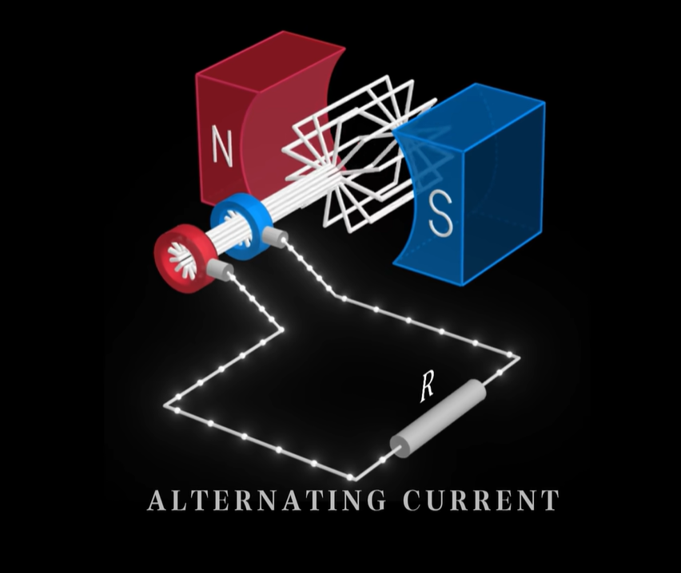

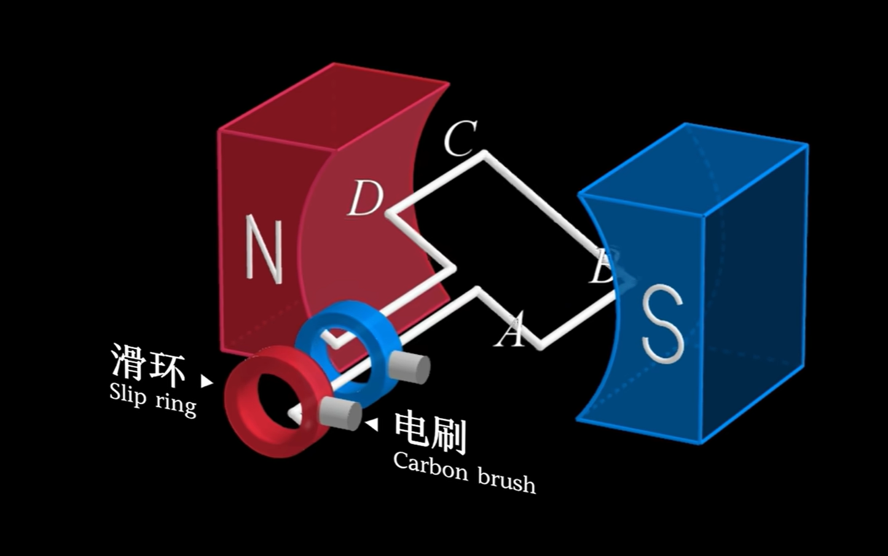

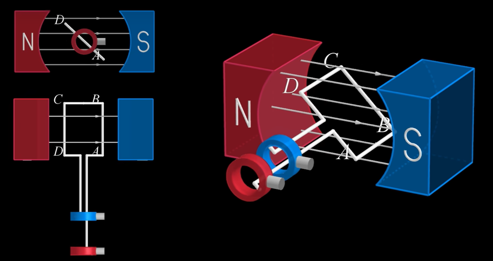

> 根据上图模型，我们发现只有`AB`和`CD`，在切割磁感线产生感应电动势；

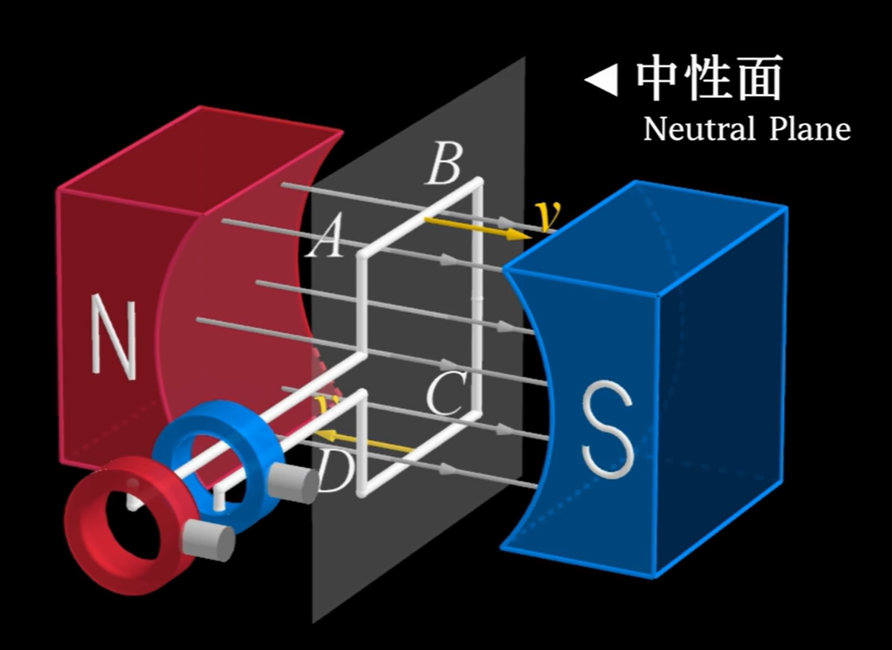

> 中性面为临界点，此处不切割磁感线所以不产生感应电动势

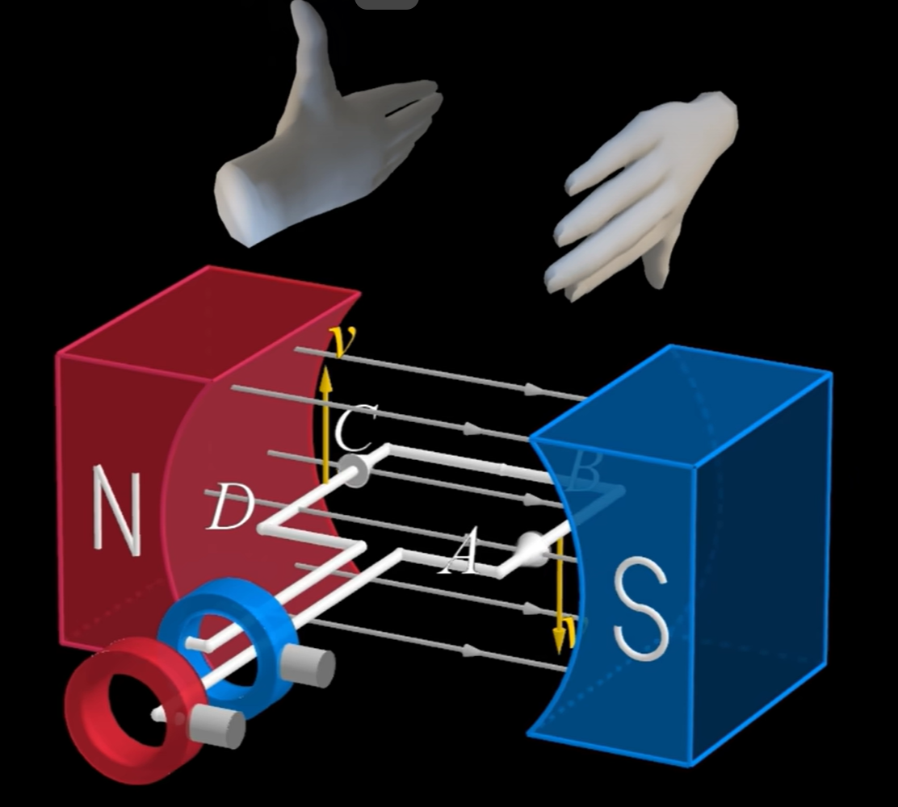

> 右手定则判断感应电流方向；

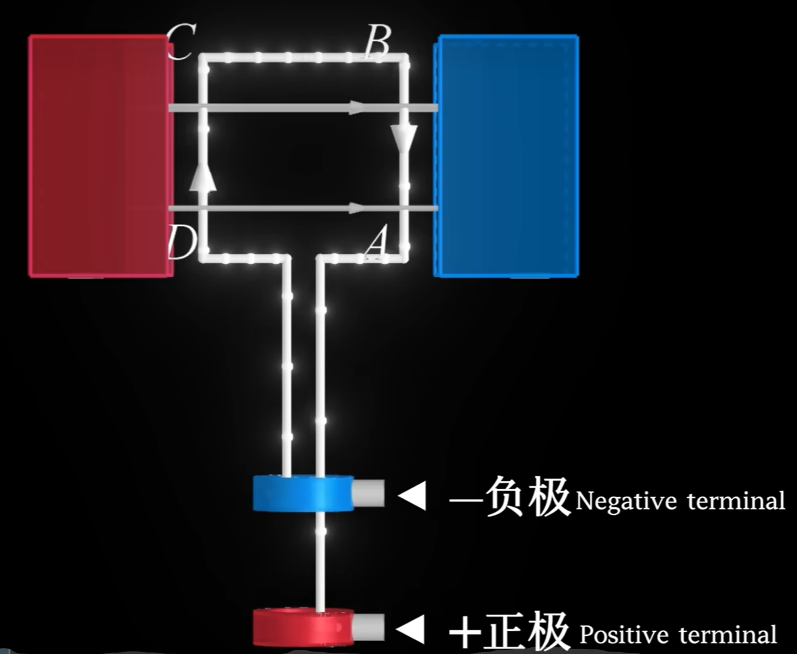

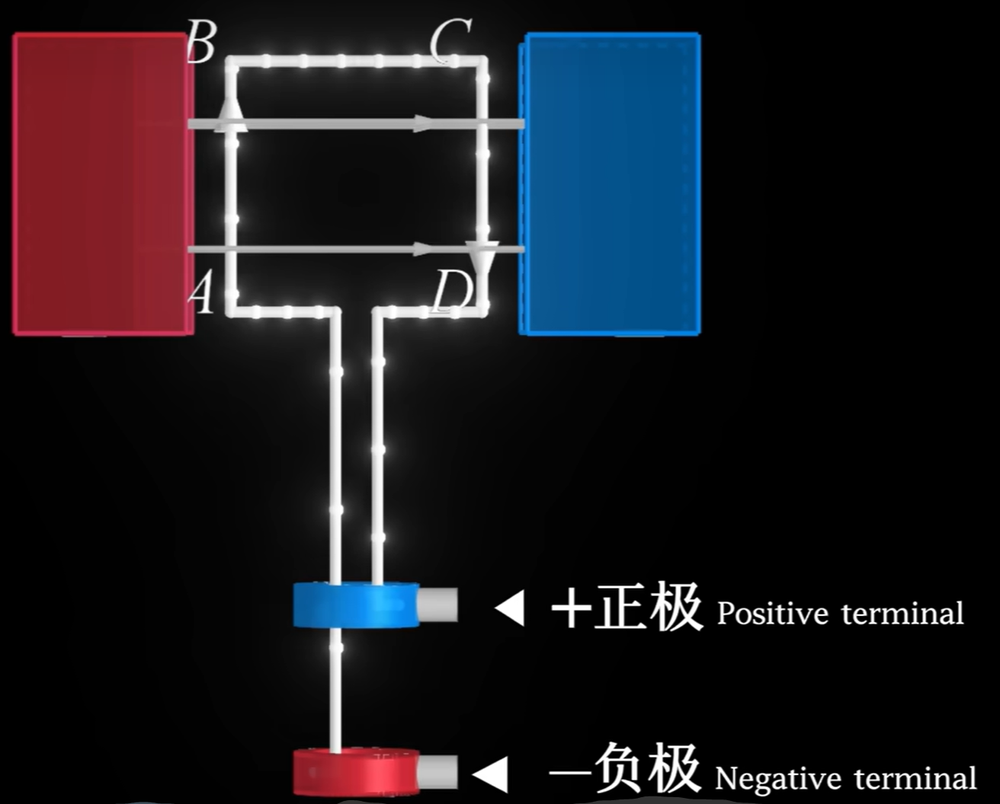

> 当旋转180度后，ab和cd交换位置，此时电流方向也刚好相反；所以在旋转的过程中，电流方向一直在发生变化；

## 感应电动势的大小

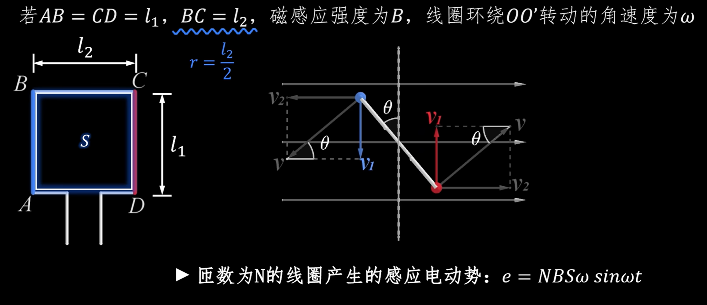

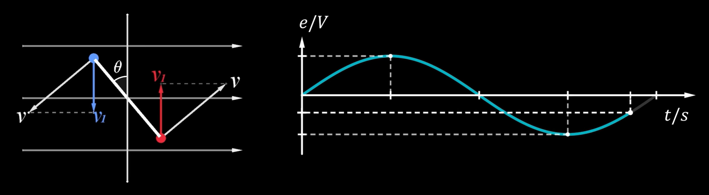

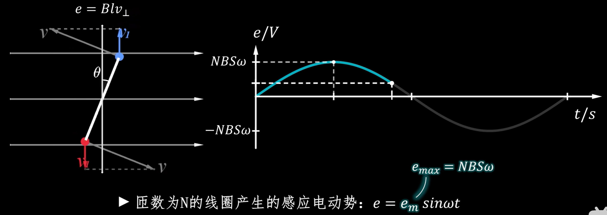

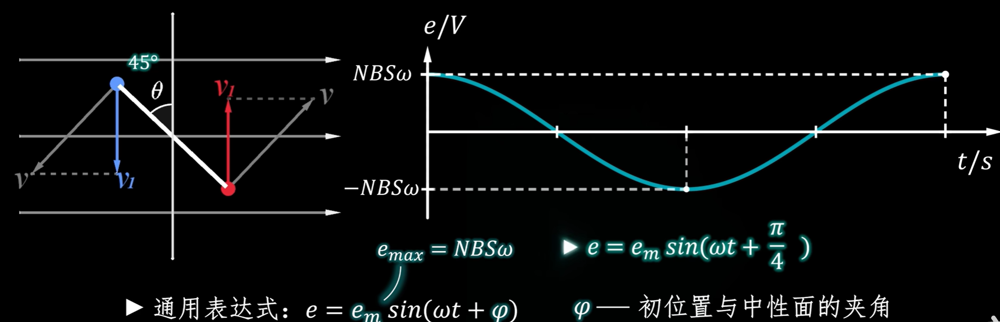

> 1、由于只有切割磁感线才会产生感应电动势，然而在旋转的过程中，会经过中性面并与中性面产生夹角；所以感应电动势也在发生着变化；
>
> 2、由于旋转线圈并不是每次都从垂直与中性面的位置开始旋转，所以感应电动势一开始也并不是最大的；（三相电的来源）

## 交流电的类型

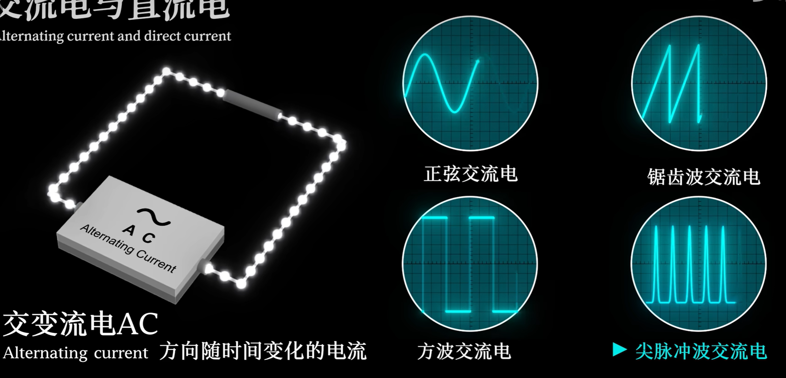

## 扩展链接

【交变电流/发电机带你轻松吃透交变电流与发电机】 https://www.bilibili.com/video/BV1pPAuzpEb6/?share_source=copy_web&vd_source=49e2f75b485d4073583f34d9794d107a

