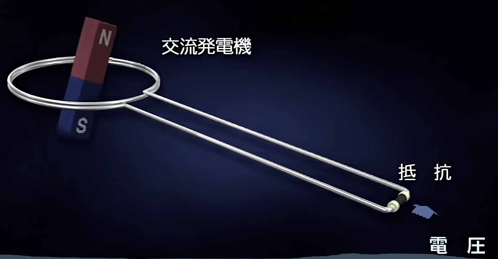
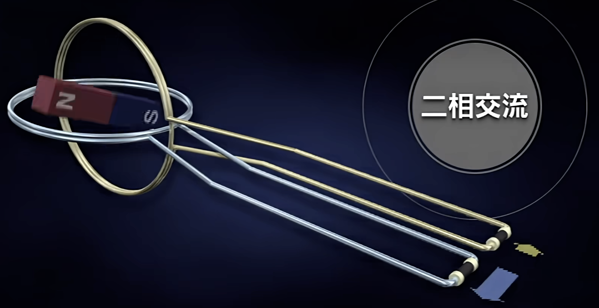
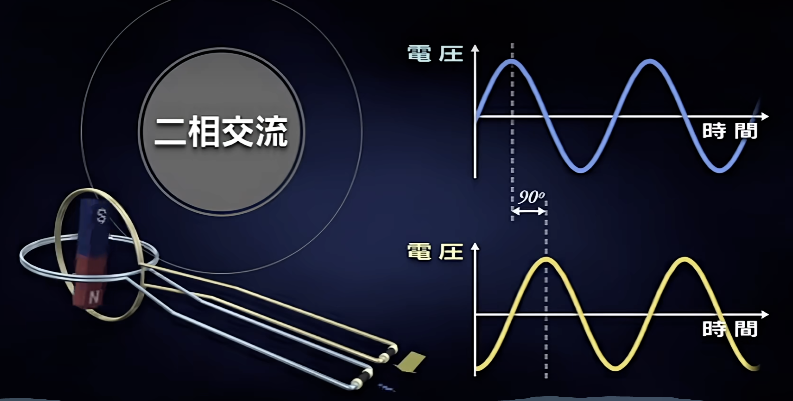
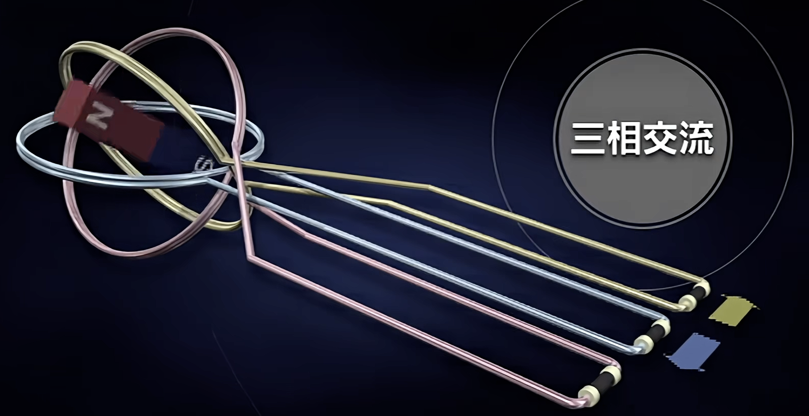
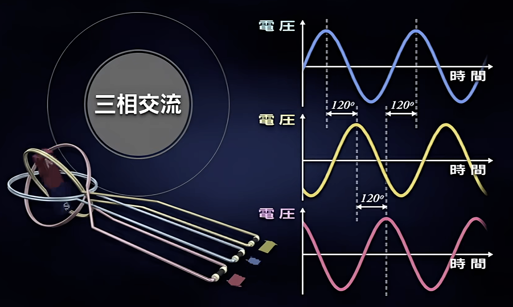
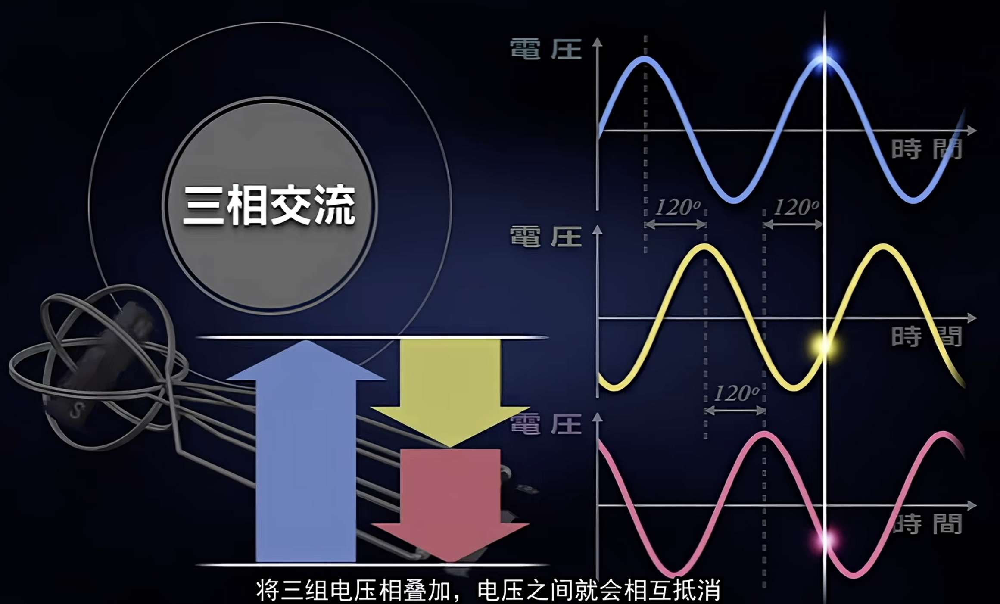
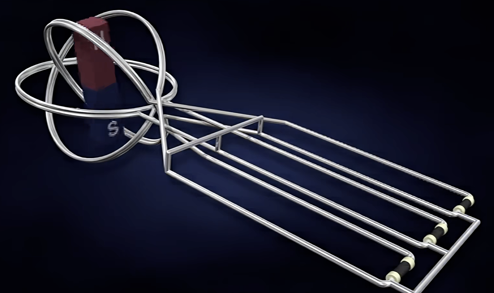
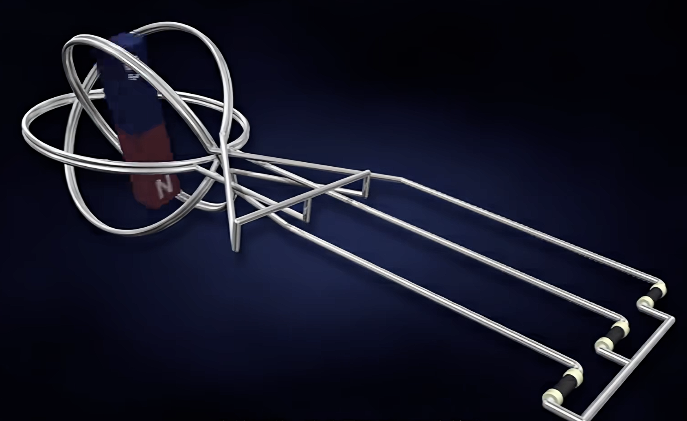
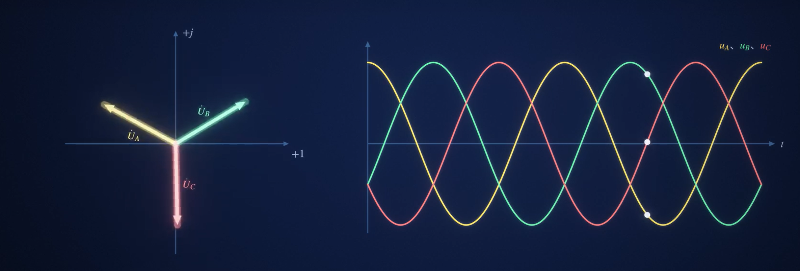
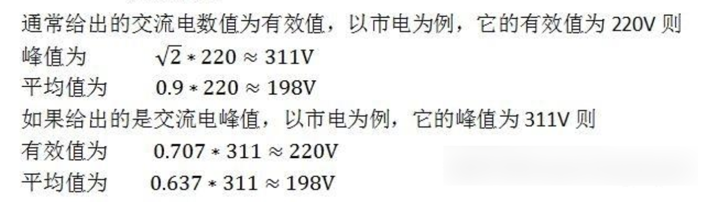

> 三相电是由三个频率相同、幅值相等、相位彼此相差120°的交流电组成的电力系统，是现代发电、输电和工业用电的主要供电方式，常见电压为380/220V

## 交流发电机基本构造

> 磁铁在线圈中旋转就会产生交变电流；

## 二相电

> 但是磁铁的周围还有空间，不妨在其中在添加一组互为90度的线圈；

> 二相交流电产生；

> 由于新的线圈旋转了90度，两个交流电压产生了90度的相位偏差；
>

## 三相电

> 如果我们分别设置三组夹角互为120度的线圈，这就是三相交流电；

> 这就是每相之间相差120度的三组交流电压；

> 将三组电压相叠加，电压之间就会相互抵消；在任何瞬间电压都为0；
>
> 因此，将三组线圈短接起来，这些之间的电压为0，将无电流通过；

> 既然被短接起来了，那么中间的无用导线就可以去掉；

> 这就是以三条导向输出的三相交流电；

## 220/380V的由来

> 19世纪爱迪生改进了灯泡，使得电能的利用得到了巨大的发展。既然有了用电器，那肯定就需要相应的供电系统，而建设完善的供电系统，就离不开一个供电标准。
>
> 爱迪生发现他改进的碳化灯丝白炽灯在110V的条件下运行良好，于是就将110V作为了标准电压,并建造了相应的发电厂。
>
> 交流电的发明者特斯拉看到了直流电远距离输送损耗大的缺陷，建立了交流电力系统，并提出了220V交流电的标准，不过由于此时在美国110V的标准已经被大量使用，所以美国大部分州沿用了110V的标准。 
>
> 随着绝缘技术的发展，220V的电压标准在欧洲被广泛使用。而我国考虑到苏联使用220V的电压标准，且220V的电压相同功率下相对110V来说传输电流更小，可以用更细的线，比较节省材料，所以采用了220V的电压标准。

## 交流电的有效值

> 交流电的大小是随着时间变化而变化的，瞬时值（某一瞬间）的大小在零和正负峰值之间变化，最大值也仅是一瞬间数值，不能反映交流电的做工能力。于是便引入有效值的概念，其定义为：
>
> 如果交流电和直流电分别通过同一电阻，两者在相同的时间内所消耗的电能相等（或所产生的焦耳热相同，即做的功相同），则此直流电的数值就叫做交流电有效值的数值。

**在一周期2π的时间里**

## 电压表的显示

> 交流电的电压和电流就像海浪——有波峰也有波谷，但电表不会显示最大值（峰值），而是显示一个“平均效果”的数值，这就是**有效值**。
>
> 举个例子：220V的家用电压，实际峰值可达311V（220V×√2），但电表始终显示220V，因为它计算的是让相同功率的电阻发热所需的直流电压值。

## 扩展链接

【三相交流的原理是什么？】 https://www.bilibili.com/video/BV1Wf4y1n7bJ/?share_source=copy_web&vd_source=49e2f75b485d4073583f34d9794d107a
