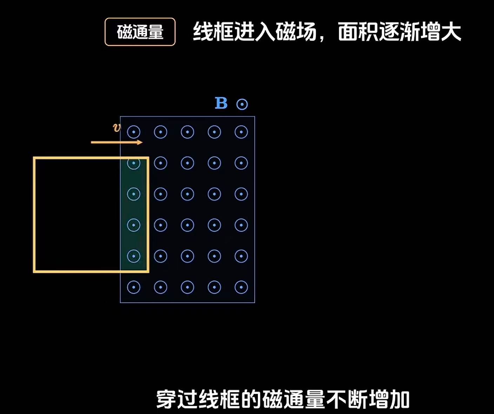
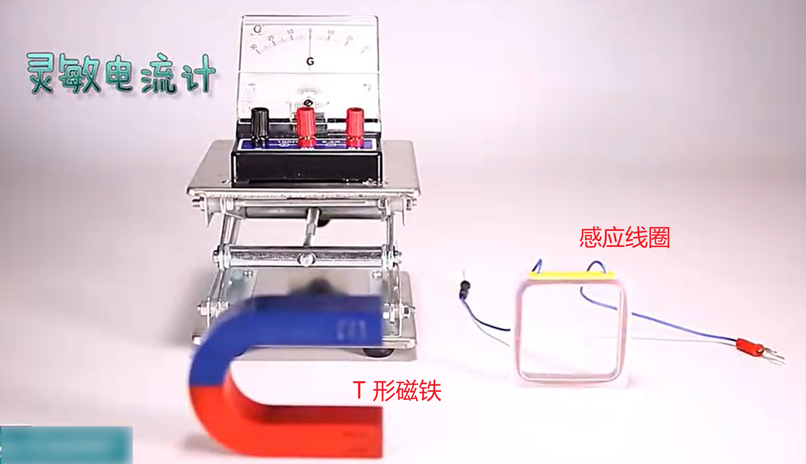
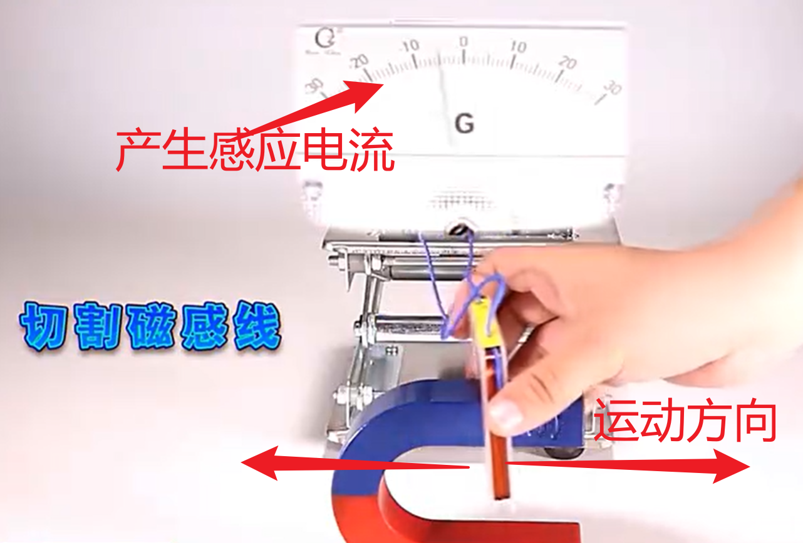
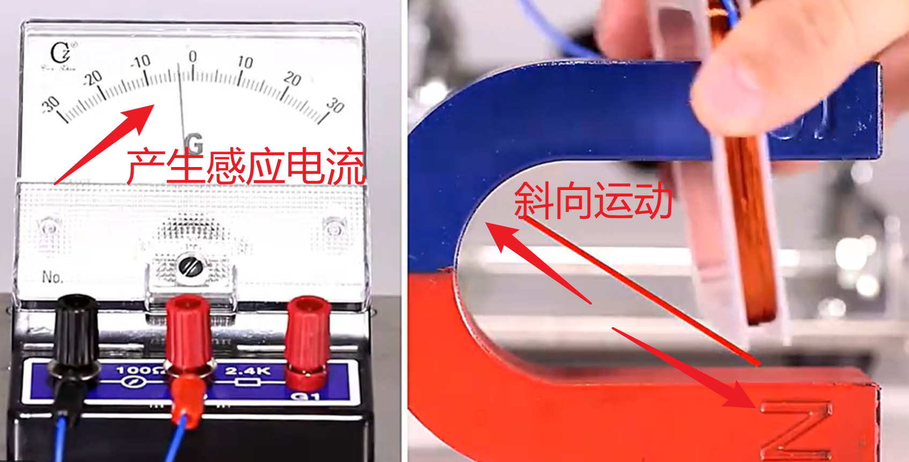
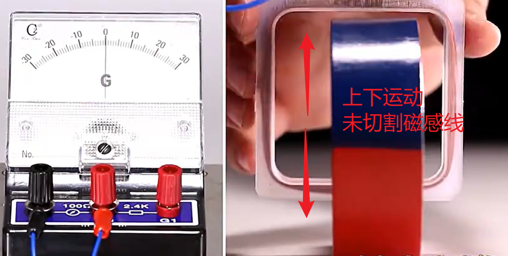
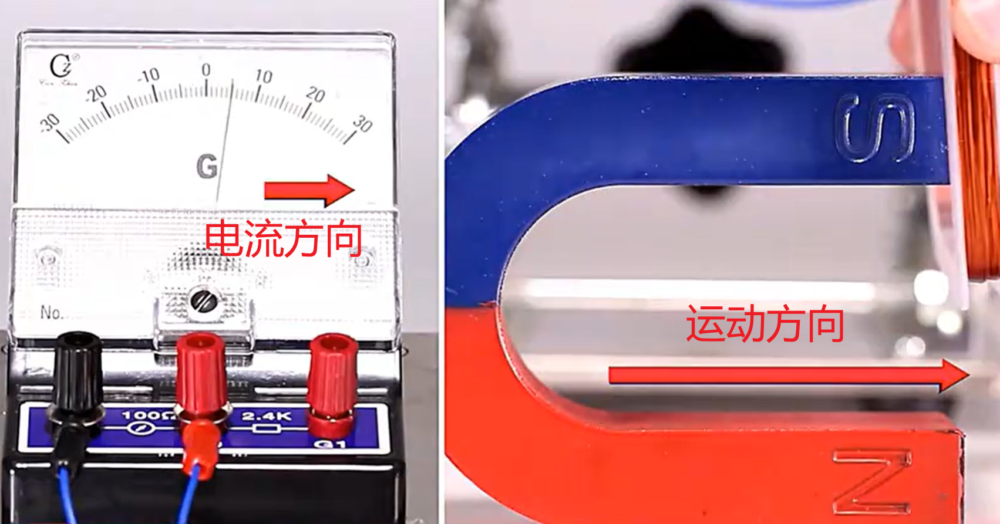
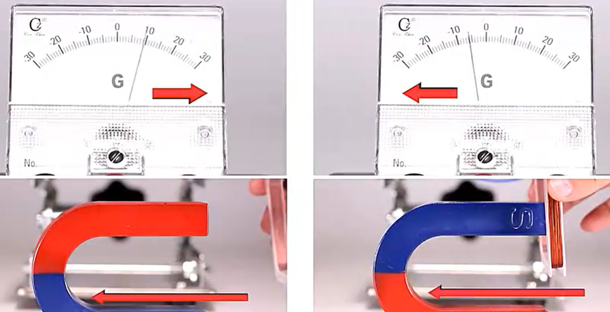
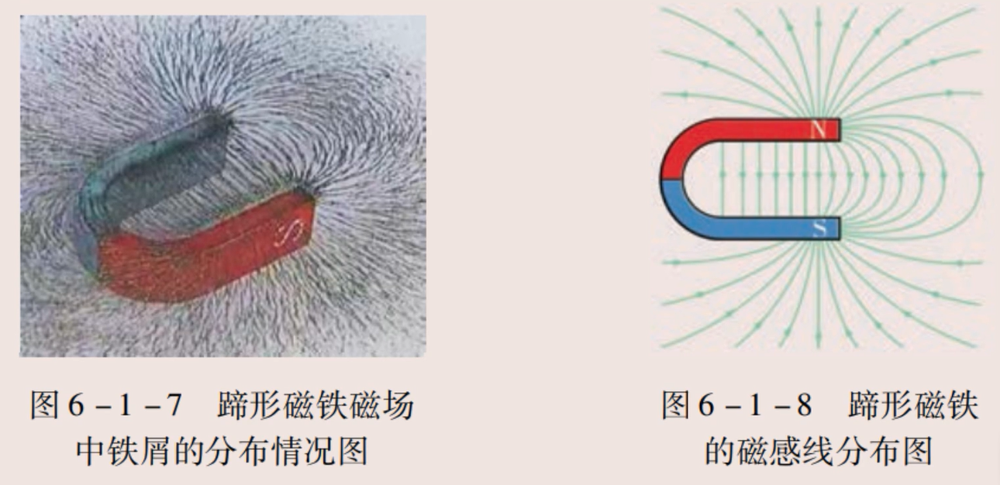
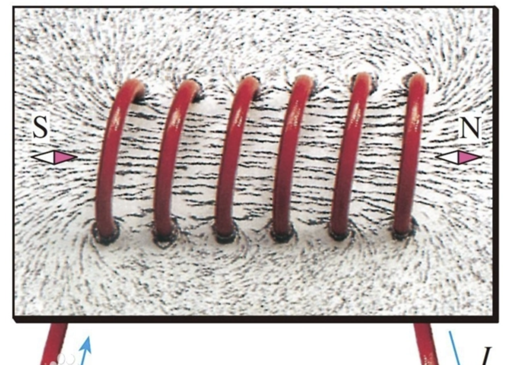

> **电磁感应现象是闭合电路的一部分导体在磁场中作切割磁感线运动时产生感应电流的现象**；
>
> 闭合电路中由电磁感应现象产生的电流叫做**感应电流**；
>
> **磁场变化**时导体中会产生**感应电动势**；
>
> 电路中感应电动势的大小，跟穿过这一电路的磁通变化率成正比；

## 原理

该现象的产生需满足两个条件

1. 闭合回路
2. 磁通量变化

实际应用涵盖发电机、电磁炉等领域；

**（如果缺少一个条件，就不会有感应电流产生）**

**磁通量**

### 实验器材

### 实验过程（水平运动）

### 实验过程（斜向运动）

### 实验过程

### 电流方向

## 楞次定律

> 判断感应电流方向的规律，指出感应电流的磁场总要阻碍引起感应电流的磁通量的变化

## 右手定则

> 伸开右手，使[大拇指](https://baike.baidu.com/item/大拇指/10951417?fromModule=lemma_inlink)跟其余四个手指垂直，并且都跟手掌在一个平面内，把右手放入磁场中，让[磁感线](https://baike.baidu.com/item/磁感线/83636?fromModule=lemma_inlink)垂直穿过[手心](https://baike.baidu.com/item/手心/52734?fromModule=lemma_inlink)（即手心正对磁场N极方向），大拇指指向导体运动的方向，那么其余四个手指所指的方向就是[感应电流](https://baike.baidu.com/item/感应电流/0?fromModule=lemma_inlink)的方向。

## 左手定则

> 伸开左手，使大拇指跟其余四个手指垂直，并且都跟手掌在一个平面内，把左手放入磁场中，让磁感线垂直穿过手心，四指指向带电粒子运动（电流所指）方向，则大拇指的方向就是导体受力的方向。

## 蹄形磁铁的磁场方向

## 通电螺线圈

> 通电螺线管是由通电线圈缠绕形成的圆柱形导体，其外部磁感线由北极发出回到南极，内部磁场方向则从南极指向北极，整体磁性与条形磁铁类似。

