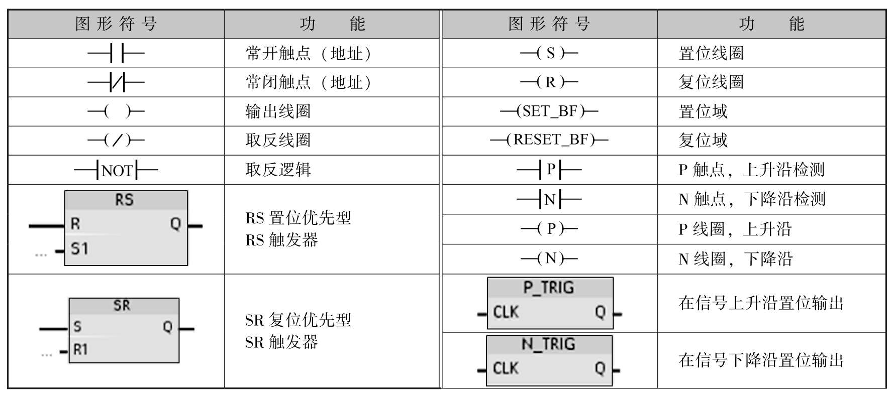
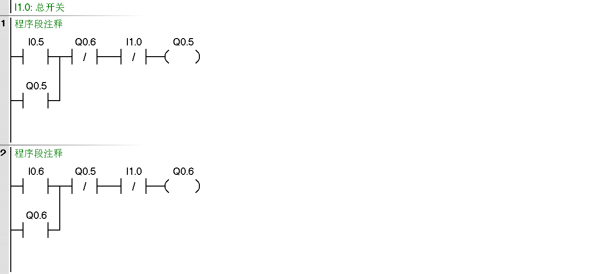
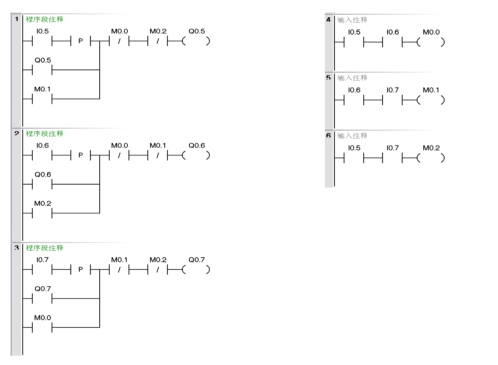
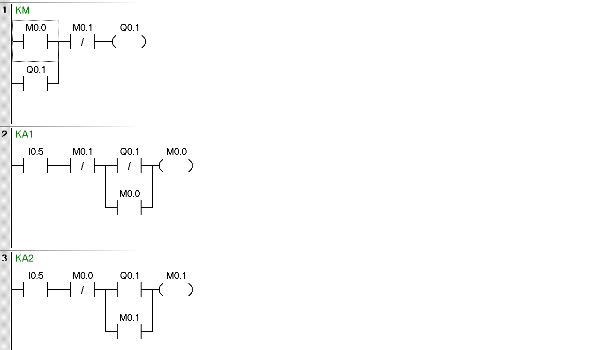
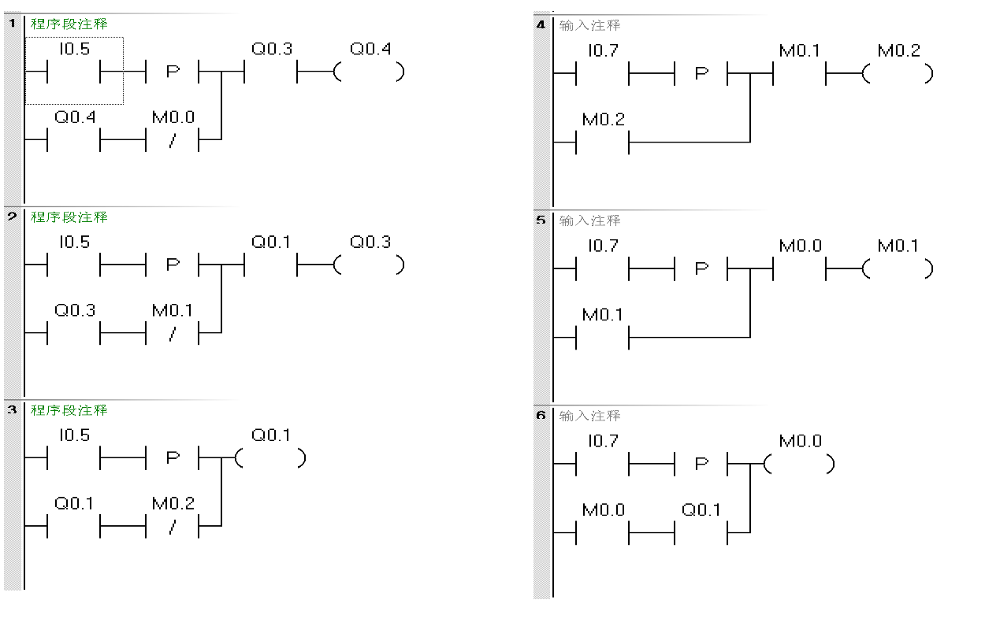
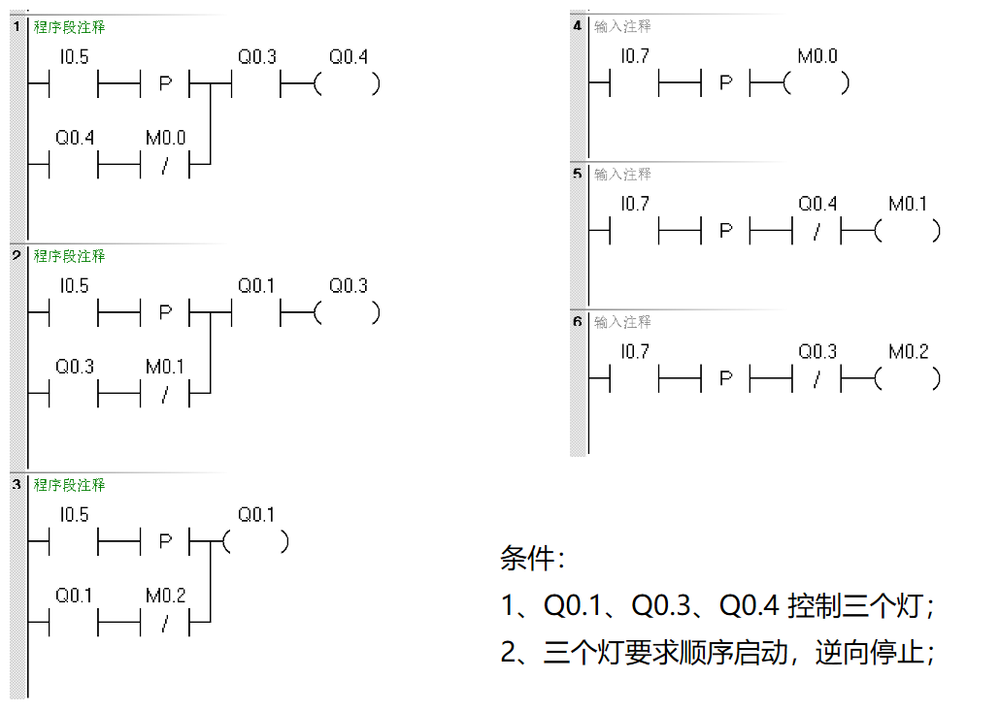
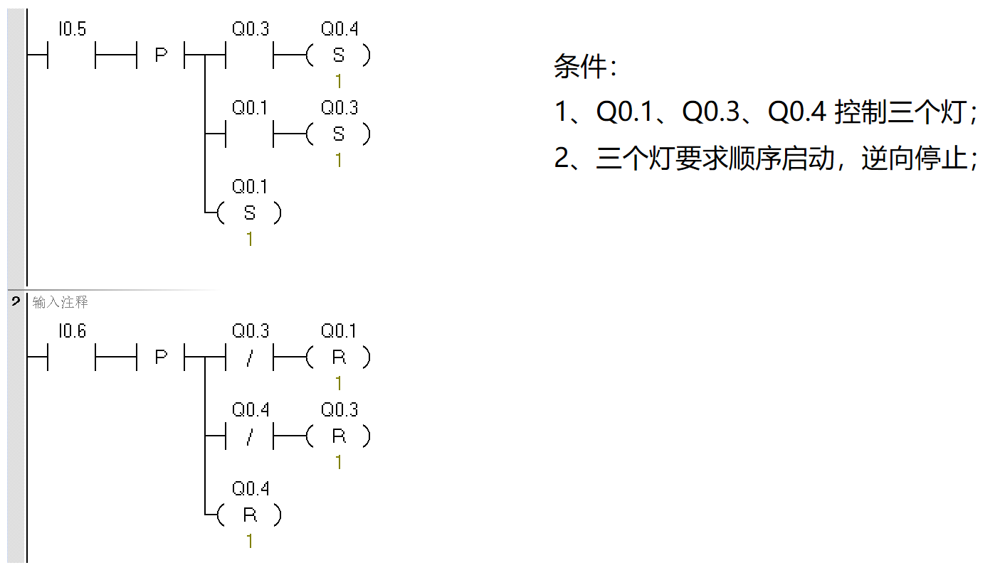
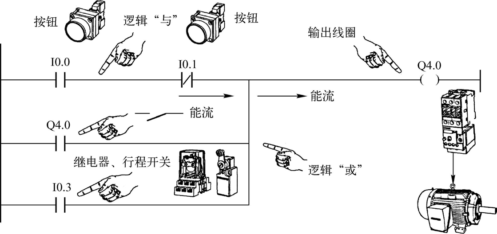
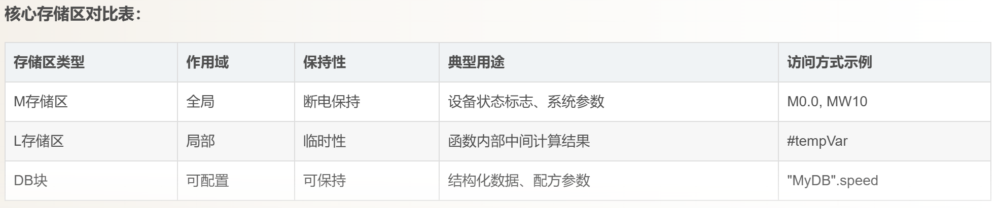

> 位逻辑指令处理的对象是**二进制位（0或1）**，在`PLC`中存储于状态字`RLO`（逻辑操作结果）中。每个位逻辑指令都有指定的地址标识;

常用存储区包括：

- **I 输入位**：如`I0.0`、`I1.0`
- **M 存储器位**：如`M0.0`、`M1.0`
- **Q 输出位**：如`Q0.0`、`Q1.0`
- **其他**：L、D、T、C等 

在触点和线圈中，1表示**真值/通电/激活**，0表示**假值/未通电/未激活**。常开触点在操作数为1时闭合，操作数为0时断开；**常闭触点则相反**；

## 指令

## `P` 上升沿 `N`下降沿

> `|P|`是上升沿触发指令，检测信号的上升沿（0→1），在信号从断开状态切换到接通状态的瞬间产生一个**扫描周期宽度的脉冲**，确保操作只触发一次，而不会在信号持续接通期间重复触发；
>
> `|N|`是下降沿触发指令，检测信号的下降沿（1→0），即信号从“1”变为“0”的瞬间，**在信号从通到断时触发一个扫描周期宽度的脉冲**，确保操作只触发一次；
> 两个指令用于检测状态的变化（信号出现或消失）

为什么要用上升沿和下降沿？不就是一个开关吗？理解这个东西还要从`PLC`的扫描周期说起，拿计数器举例。

假设需要实现 **每按一次按钮，`VW100`的数值加1** 的功能：

- 如果按钮接到`I0.0`，而程序中没有`|P|`指令，按下按钮并**保持接通**时，`PLC`会在每个扫描周期对`VW100`加1，可能导致数值累加错误。
- 如果在`I0.0`触点后加入`|P|`指令，无论按钮按下多长时间，`PLC`只会在上升沿触发一次加1操作，保证计数精确。

> 使用`|P|`指令可以防止因**按钮长时间按下**或**信号持续接通**导致的重复操作，保证系统稳定性和可靠性。
>
> 指令产生的脉冲宽度为一个扫描周期，因此动作必须在一个周期内完成；

## `M` 存储区

> 西门子PLC的M点数量没有固定值，它完全取决于您所使用的PLC系列以及具体的CPU型号。M区（位存储区）的大小在CPU出厂时即已预定义，无法通过软件进行扩展。
>
> **S7-200**系列：M区地址空间非常有限，仅为32个字节（对应地址`M0`至`M31`）。 这意味着可用的位地址（M点）最多只有**256**个，在复杂程序中极易耗尽；
>
> 而现代的S7-1500系列，其M区最大可达16KB，对应从MB0到MB15999的地址范围，理论上可提供超过12.8万个位地址（M点）
>
> M点，即**M存储区**，是西门子PLC内部的通用辅助继电器或位存储区。 它不属于物理输入输出，主要作用是在程序内部连接不同程序段、存储中间运算状态或作为辅助编程变量。

## 代码

### 自锁+互锁

### P+M 的应用

> 有三个按钮分别控制三个灯是I0.5,10.6,10.7,Q0.5,Q0.6,Q0.7,
>
> 按下10.5,Q0.5亮并保持,按下I0.6,Q0.6亮并保持,按下I0.7,Q0.7亮并保持,
>
> 同时按下10.5 10.6,Q0.5,Q0.6灭,Q0.7亮并保持。
>
> 同时按下I0.6,10.7,Q0.6,Q0.7灭，Q0.5亮并保持。
>
> 同时按下I0.5,10.7,Q0.5,Q0.7灭，Q0.6亮并保持。

### 单按钮启停

> 一个按钮控制一个灯的开启和关闭；
>
> 条件：I0.5控制Q0.1的启动和关闭

### 顺序启动逆向停止

> 条件：
>
> 1、I0.5、I0.6、I0.7分别对应三个常开的开关；
>
> 1、Q0.1、Q0.3、Q0.4 控制三个灯；
>
> 2、三个灯要求顺序启动，逆向停止；

### 顺序启动逆向停止-V2

### 顺序启动逆向停止-V3

## 扩展

