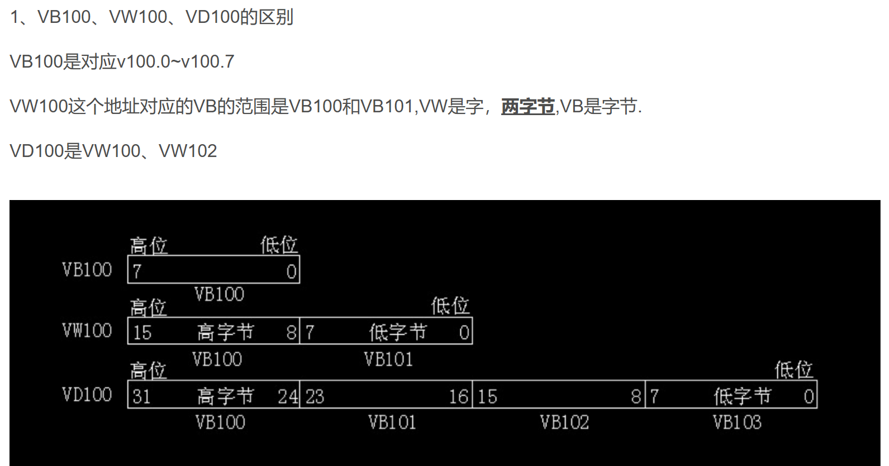
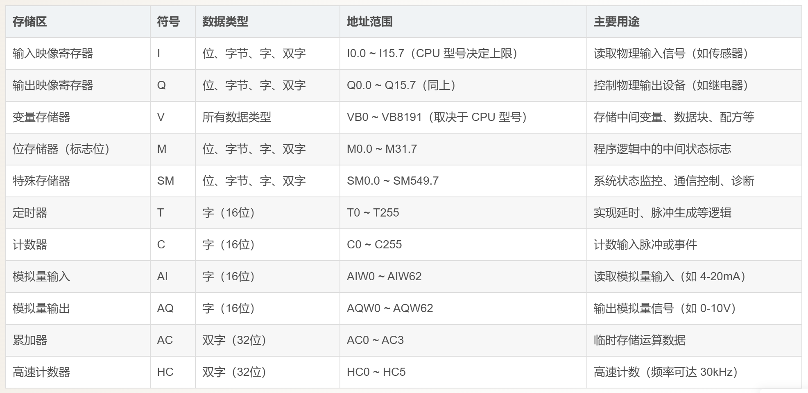
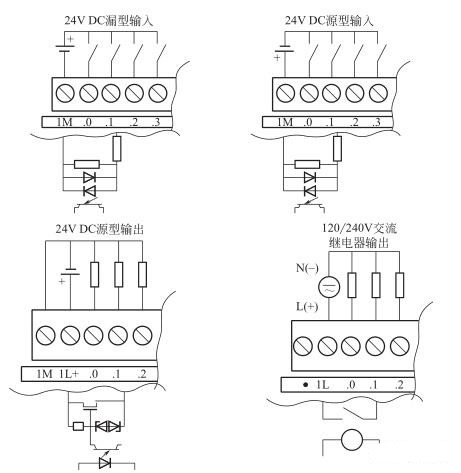
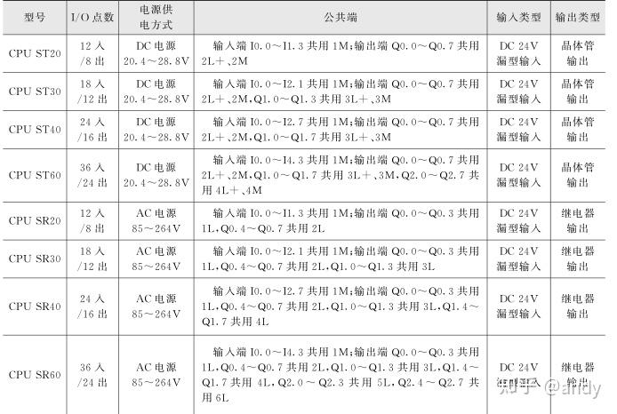
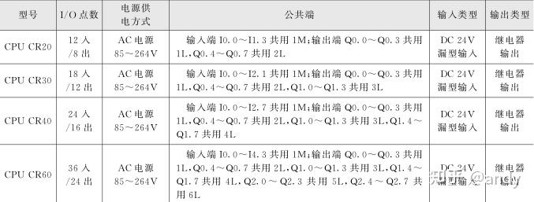
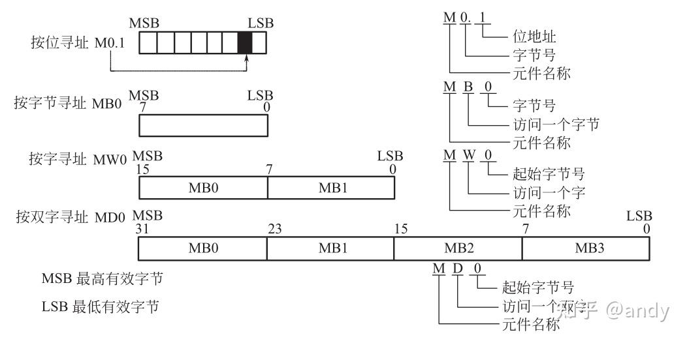
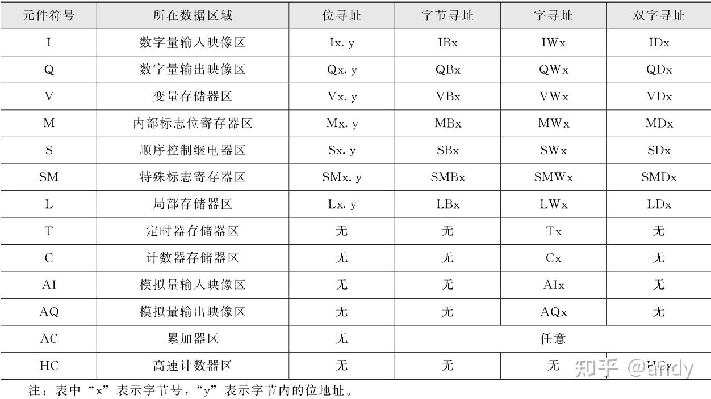
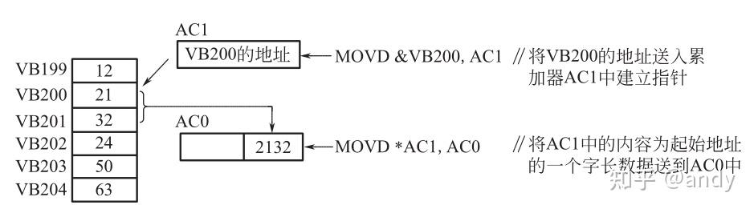
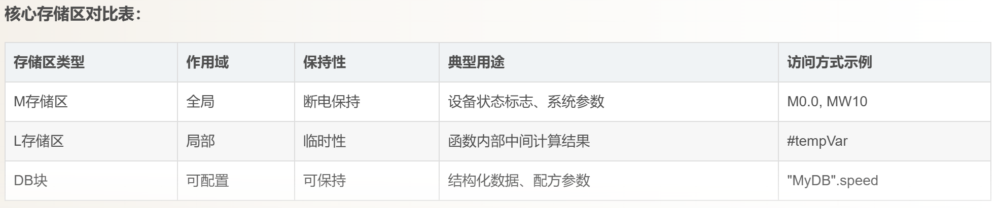

> S7‑200 SMART存储区随CPU型号不同：
>
> - 小型项目：ST20（V=8KB） 
> - 中型项目：ST30/40（V=12KB/16KB） 
> - 大型项目：ST60（V=20KB)

## 存储区

> 将信息存储在不同的存储单元,每个单元都有唯一的地址,系统允许用户以字节、字、双字的方式存取信息。

### 输入/输出映像寄存器

- **I区**：PLC 在每个扫描周期开始时读取物理输入信号，并存入I区，共256位（32字节）；
  - 从`I0.0`到`I31.7`;
- **Q区**：程序逻辑运算结果写入Q区，扫描周期结束时输出到物理设备，256位（32字节）； 
  - 从`Q0.0`到`Q31.7`;

### 变量存储区

- **作用**：存储程序变量，可保存整数、浮点数、字符串等多种数据类型。
- **范围**：通常为`VB0到VB20479`（具体取决于CPU型号）。
- `V`表示**变量存储区（Variable Memory）**，用于存放程序运行过程中的中间数据、参数、标志等。
- VB是对V区的一种按字节（Byte）寻址的访问方式；
- **灵活性**：支持按位V、字节（VB）、字（VW）、双字（VD）访问。
- **VB(1字节) → VW(2字节  )→ VD(4字节)**
- **应用**：存储传感器值、PID参数、中间计算结果等。

#### **VB（Variable Byte）**

- **含义**：用于存储和操作字节，每个VB存储器只占用一个字节，8个位；
- **寻址方式**：*VBn*表示V区第n个字节，例如*VB100*表示V区地址100的一个字节。
- **用途**：适合存储短整型数据或单字节标志。
- 例如：VB5，对应V5.0~V5.7【访问V区的**一个字节**（8位，0~255）。】

#### **与VW、VD的区别**

- **VW**：访问V区的一个字（Word，16位，2字节），如*VW100*包含*VB100*和*VB101*。
- **VD**：访问V区的一个双字（Double Word，32位，4字节），如*VD100*包含*VB100*~*VB103*。

### 内部存储器

- 256位（32字节）;
- 从`M0.0`到`M31.7`;

### 特殊存储器

- 约1600字节;
- 提供系统状态信息和控制位，例如：
  - `SM0.0`：始终为 1（用于无条件执行）。
  - `SM0.1`：首次扫描时为 1（初始化用）。
  - `SMW22`：扫描周期时间（毫秒）。
- 控制通信端口、高速计数器等。

### 定时器和计数器

- **定时器类型 T区**：
  - TON（通电延时）、TOF（断电延时）、TONR（保持型）。
- **计数器类型 C区**：
  - CTU（加计数器）、CTD（减计数器）、CTUD（加减计数器）。

### 模拟量处理（AI/AQ）

- **分辨率**：12位（0~32000 对应 4-20mA 或 0-10V）。
- **接线注意**：需外接信号调理模块（如 EM231、EM232）。

## V 地址详解

- ST20：8192字节；
  - 一共有`V0.0`到`V8191.7` `65535`个地址;
  - 可以表示的Byte类型8位 (1字节)；
    - `VB0` ---> `V0.0` 到 `V0.7`；
    - `VB1` ---> `V1.0` 到 `V1.7；`
    - 一个`VB`的十进制范围是 `0 ~ 255；`
    - 一共有`VB0` 到 `VB8191`个地址；【`VB8191` ---> `V8191.0` 到 `V8191.7`】；
    - *绝对没有 `VB0.0` 这种写法！带 `B` 就是字节，不带 `B` 且带点，才是位。*
  - 可以表示的**Word**类型16位 (2字节)；
    - 必须是 2 的倍数;
    - `VW0`  ---> `VB0` + `VB1` ---> `V0.0` 到 `V1.7` 一共16个位；
    - 一个`VW`的十进制范围是 `0 ~ 65535`；
    - 因为 `VW` 是占 2 个字节，最后一个字节是 `VB8191`，那么它和前面的 VB8190 组成了最后一个字：**`VW8190`**。
    - 只有偶数地址（VW0, VW2, VW4...）。VW0 的下一个是 VW2。没有 VW1 这个东西。
    - 所以一共有`VW0` 到 `VW8190`个地址；这 4096 个合法的字地址（全是偶数）
    - **`VW8190`**（1个字，合法的最后一个字） **= `VB8190` + `VB8191`**（2个字节）**= `V8190.0` 到 `V8190.7` 加上 `V8191.0` 到 `V8191.7`**（16个位）。
  - 可以表示的**DWORD**类型32位 (4字节)；
    - 双字（VD）的地址编号**必须是 4 的倍数**。
    - `VD0` --->  **`VW0` + `VW2` ---> `VB0` + `VB1` + `VB2` + `VB3` ---> `V0.0` 到 `V3.7`（共 32 个位）。**
    - 一个`VD`的十进制范围是`0 ~ 4294967295`;
    - 一共有`VD0` 到 `VD8188`;
    - **`VD8188`**（最后 1 个双字）= 等于 **`VW8188` + `VW8190`**（2 个字） =  等于 **`VB8188` + `VB8189` + `VB8190` + `VB8191`**（4 个字节，完美触达你 8191 的上限！）;

> - **位（Bit）**：编号 0~7
> - **字节（Byte）**：编号连续 +1（0, 1, 2, 3...8191）
> - **字（Word）**：编号连续 +2，**全是偶数**（0, 2, 4...8190）
> - **双字（DWord）**：编号连续 +4，**全是 4 的倍数**（0, 4, 8...8188）

## 基本模块的I/O

> 西门子 S7-200 SMART系列 PLC 基本模块的 I/O 包括输入端子和输出端子,作为数字量I/O 时,输入方式分为[直流 24V 源型](https://zhida.zhihu.com/search?content_id=240638312&content_type=Article&match_order=1&q=直流+24V+源型&zhida_source=entity)和漏型输入;输出方式分为直流 24V 源型的晶体管输出和交流 120 / 240V 的[继电器输出](https://zhida.zhihu.com/search?content_id=240638312&content_type=Article&match_order=1&q=继电器输出&zhida_source=entity),它们的接线方式如图所示。

基本模块的型号不同,它们的 I/O 端子数和输出方式不同,其具体情况如下所示。表中前 8 种型号为标准型,其余为经济型。

## 寻址方式

> **使用数据地址访问数据称为寻址**,指定参与的操作数据或操作数据地址的方法,称为**寻址方式**。

西门子 S7-200 SMART PLC 有**[立即数寻址](https://zhida.zhihu.com/search?content_id=240670969&content_type=Article&match_order=1&q=立即数寻址&zhida_source=entity)、直接寻址和间接寻址三种寻址方式**。

### 立即数寻址

数据在指令中以常数形式出现,取出指令的同时也就取出了操作数据,这种寻址方式称为立即数寻址方式。

常数可分为字节、字、双字型数据。

 CPU 以二进制方式存储常数,指令中还可用十进制、十六进制、 ASCII 码或浮点数来表示。

### 直接寻址

在指令中**直接使用存储器或寄存器元件名称或地址编号来查找数据**,这种寻址方式称为直接寻址。

直接寻址可按位、字节、字、双字进行寻址。

### 间接寻址

在 S7-200 SMART PLC 中,可间接寻址的元器件有 I 、 Q 、 V 、M 、S 、T 和 C ,其中 **T 和 C 只能对当前值进行**。使用间接寻址时,首先要建立指针,然后利用指针存取数据。

①建立指针 **指针为 32 位的双字**,在西门子 S7-200 **SMART PLC 中,只能用 V 、 L或 AC 作为地址指针**。生成指针时需使用双字节传送指令,指令中的内存地址 (操作数)前必须使用 “ & ”,表示内存某一位位置的地址。例如: MOVD&VB200 , AC1这条指令是将 VB200 的地址送入累加器 AC1中建立指针

②利用指针存取数据 指针建立好后,利用指针来存取数据。**存取数据时同样需使用双字节传送指令**,指令中**操作数前必须使用 “ \* ”**,表示该操作数作为地址指针。例如,执行上条指令后,再执行 “ MOVD*AC1 , AC0 ”后,将 AC1 中的内容为起始地址的一个字长数据送到 AC0 中。操作过程如图所示

## 注意事项

- **地址对齐**：VW和VD的起始地址应为偶数，以避免跨字节访问错误。
- **数据类型匹配**：指令的数据类型必须与存储格式一致，否则会出现计算错误。
- **避免重叠**：如*VB100*与*VW100*会共享内存，修改一个会影响另一个。

## 扩展链接

- [源链接](S7-200 SMART PLC的基本模块的I/O - Andrew.Devo的文章 - 知乎
  https://zhuanlan.zhihu.com/p/686286158)
- [西门子 S7 - 200 SMART PLC 存储器范围及特性](https://zhuanlan.zhihu.com/p/686433823)
