## GET/PUT通信

> 西门子 S7 系列 PLC 之间的“私有协议”，主要用于西门子设备间的数据交换。
>
> - **核心特点**：**单边通信**。只需要在主动站（客户端）编写程序，调用 `GET`（读）或 `PUT`（写）指令，被动站（服务器）无需编程，配置好 IP 即可。
> - 不需要远程设备的**同意**，直接获取或者推送数据；

### `PLC1`主设备

#### 下载

先连接上PLC然后下载；

#### GET/PUT配置向导

> 添加两个操作，一个用于获取一个用于推送
>
> - get
>   - 类型：GET
>   - 传送大小（字节）：需要获取远程的数据大小
>   - 本地地址：QB
>   - 远程地址：IB
> - put
>   - 类型：PUT
>   - 传送大小（字节）：需要发送给远程的数据大小
>   - 本地地址：IB
>   - 远程地址：QB

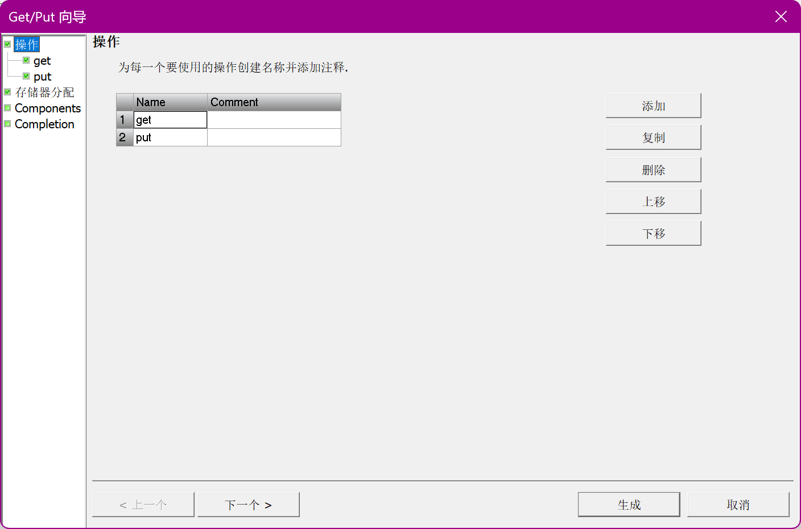

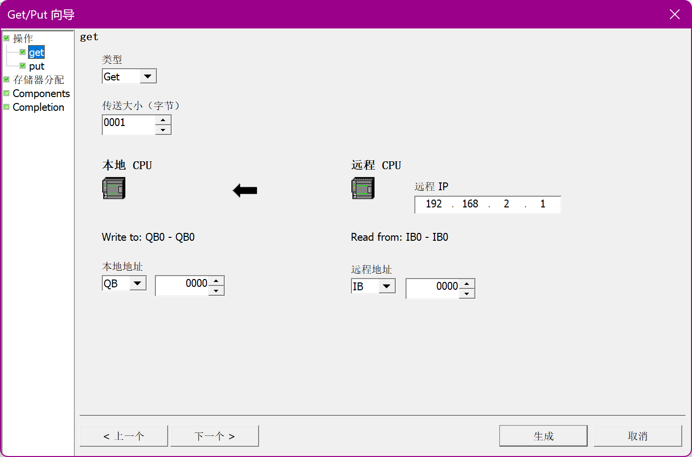

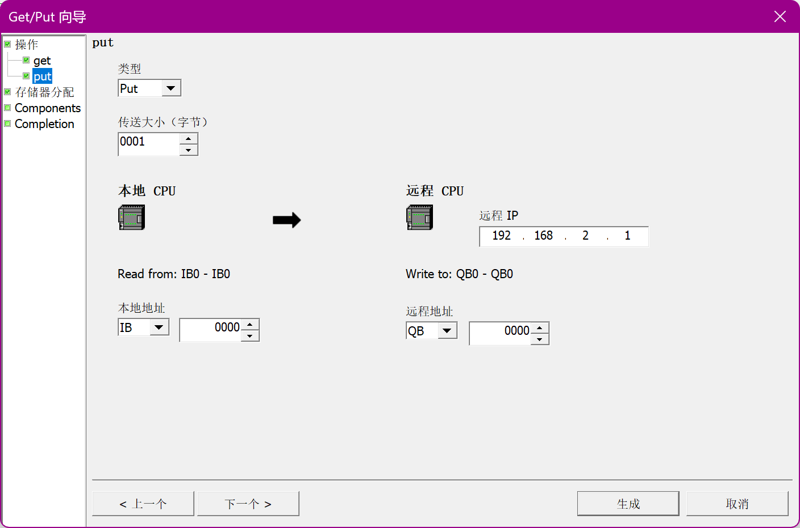

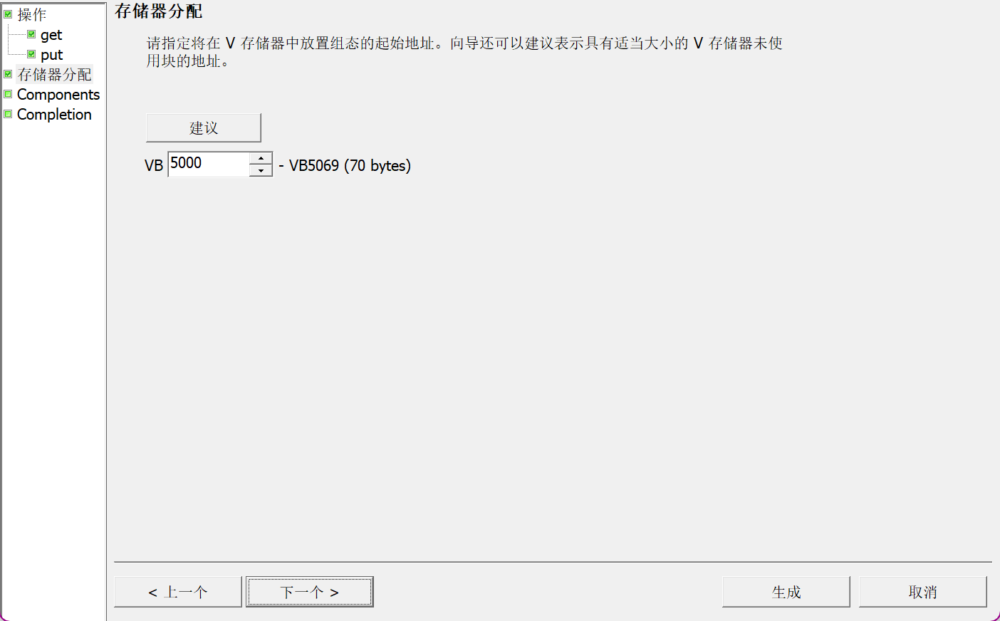

> 最后点击完成！

#### 编程

### `PLC2` 从设备

> 从设备不需要配置也不需要写代码编程，只需要连接`PLC`从设备，然后下载、运行就可以了；

#### 网口线直连

> 使用同一根网线连接两个PLC设备；

## `PROFIENT`通信

> 基于工业以太网的标准协议，具有**实时性**，用于连接分布式 I/O 设备（如远程站、变频器、阀岛）
>
> - **核心特点**：**组态式通信**。需要导入设备的 GSD 文件，在软件中组态网络拓扑。
> - **适用场景**：控制远程 I/O、驱动伺服/变频器，要求数据刷新周期短、确定性高。每个设备最大支持 128 字节的输入/输出区域。
> - 工业实时总线，面向控制

### 智能设备

#### 下载

先连接上PLC然后下载；

#### PROFIENT 配置向导

> - 修改IP地址：和本地连接的IP地址相同；
>
> - 修改站名：唯一的名称，需要和其它PLC设备区分开；
> - 传送区
>   - 传送区名称：自定义；
>   - 类型：输入/输出；
>   - 地址：有效范围从 `IB/QB1152` 到 `IB/QB1279；`
>   - 长度：输入/输出的长度最多支持128个字节；
> - 导出配置到指定文件夹中；
> - 最后点击生成；

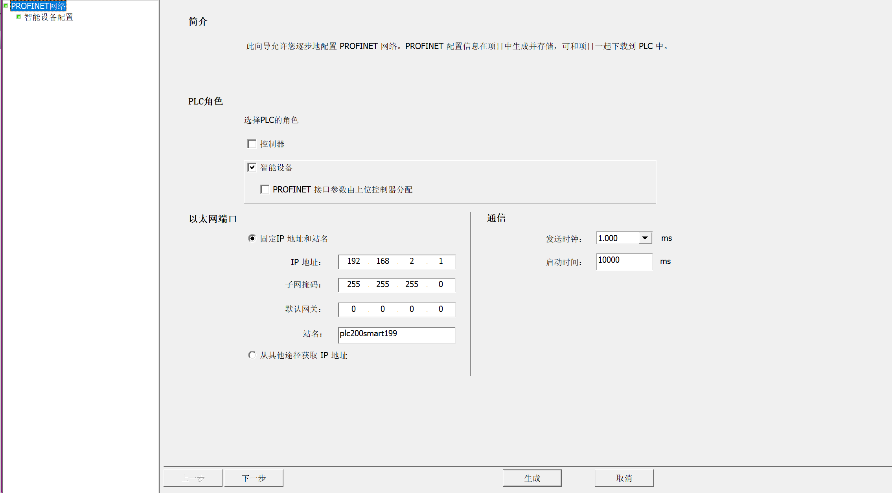

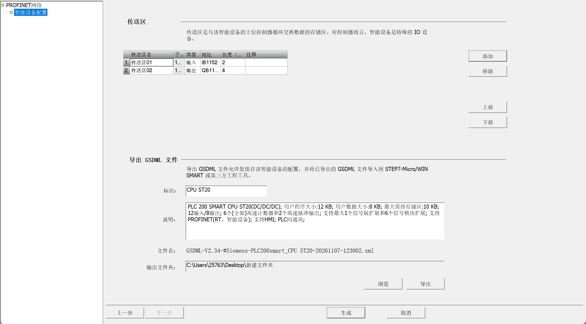

#### 编程

> 根据前面的配置向导的数据，进行如下编程；
>
> - 使用`IB1152`接收控制器发送的过来的数据；
> - 使用`QB1152`发送数据给控制器；
> - 使用`R`指令置位发送的数据，然后准备下一次发送；

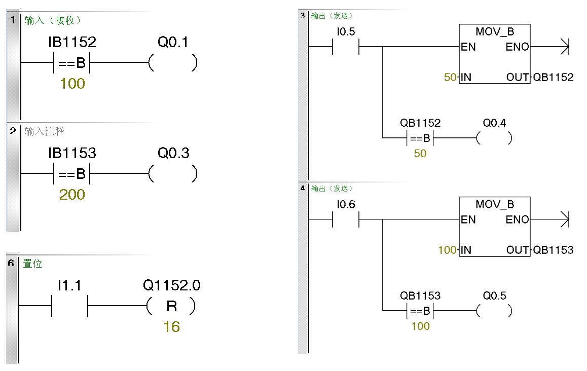

### 控制器

#### 下载

先连接上PLC然后修改IP地址并下载；

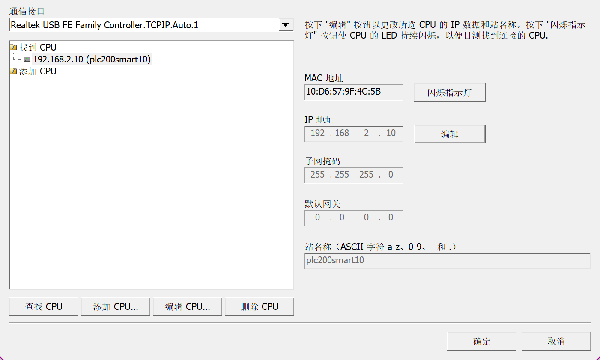

#### PROFIENT 配置向导

> - 修改IP地址：和本地连接的IP地址相同；
>
> - 修改站名：唯一的名称，需要和其它PLC设备区分开；
> - 设备表：
>   - 手动拖动右侧最后面的`CPU ST20V02.08.02`,放到设备表的第一个位置；

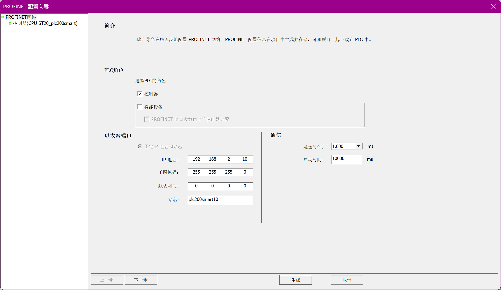

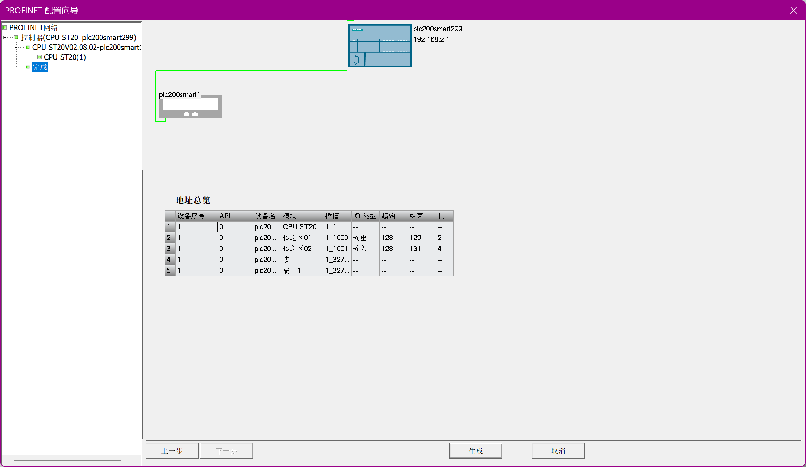

> 输入起始地址范围为：`128 ~ 252` 
>
> 输出起始地址范围为：`128 ~ 254` 

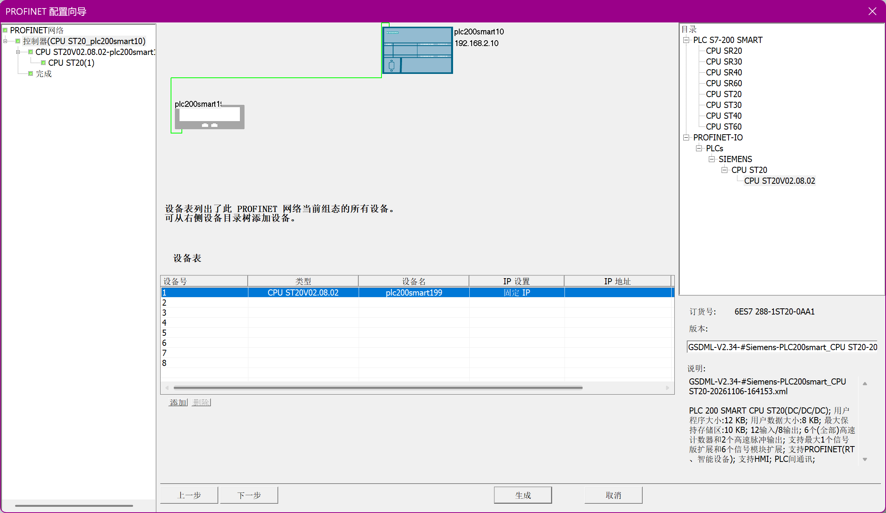

> 点击下一步，直到 完成；

#### 编程

> 根据前面的配置向导的数据，进行如下编程；
>
> - 使用`IB128`接收设备发送的过来的数据；
> - 使用`QB128`发送数据给设备；
> - 使用`R`指令置位发送的数据，然后准备下一次发送；

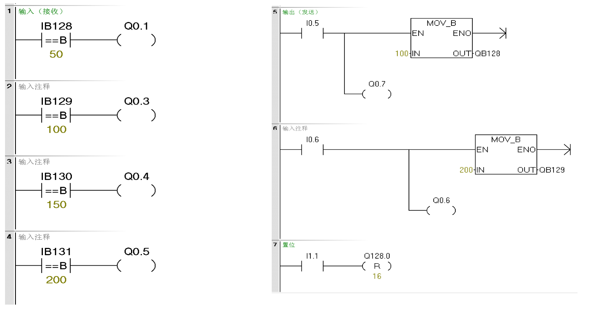

### 网口线直连

> 使用同一根网线连接两个PLC设备；

## TCP通信

> 标准的开放式用户通信（OUC），用于与**第三方设备**（如机器人、视觉系统、PC、非西门子 PLC）通信。
>
> - **核心特点**：**双向编程**。通信双方通常都需要调用 `TCP_CONNECT`、`TCP_SEND`、`TCP_RECV` 等指令库来建立连接和收发数据。它是一种“流”协议，没有消息边界，需要双方约定好数据长度。
> - **适用场景**：跨品牌设备集成。单次收发数据量较大，最大可达 **1024 字节**
> - 用于通过 TCP 协议创建到另一设备的连接，适用范围更广；

### 发送端

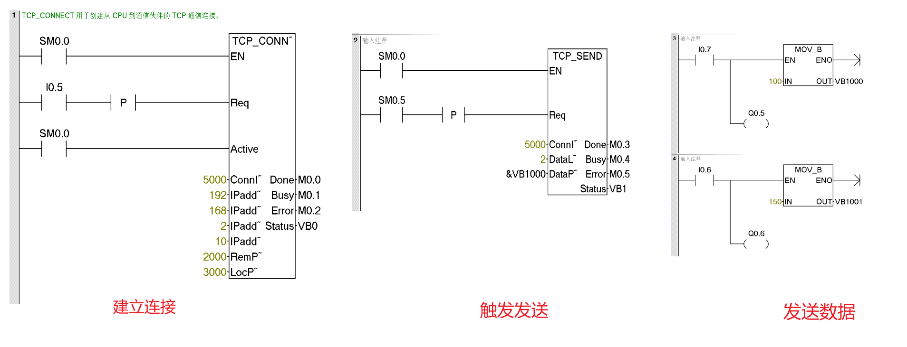

> 参数说明
>
> - TCP_CONNECT 
>   - Req：Req = TRUE，CPU 启动连接操作**只需要建立一次即可**
>   - Active：TRUE = 主动连接 FALSE = 被动连接
>   - ConnID：连接 ID 范围为 0 到 65534；
>   - IPaddr1 ~4：192.168.2.10**（远程设备/接收端IP地址）**
>   - RemPort：远程设备上的端口号，范围为 1 到 49151；（建议采用的端口号范围为 2000 到 5000）
>   - LocPort：本地设备上的端口号，范围为 1 到 49151**（建议和RemPort不同）**
> - TCP_SEND 
>   - Req：为 TRUE 时，启动发送操作；
>   - ConnID：与建立连接的标识相同；
>   - DataLen：要发送的字节数（1 到 1024，在一个发送操作中最多可以发送 1024 字节的数据）。
>   - DataPtr：指向待发送数据的指针。这是指向 I、Q、M 或 V 存储器的 S7-200 SMART 指针（例如，＆VB1000）。
> - 发送数据
>   - 通过给VB赋值的方式给远程发送数据；

### 接收端

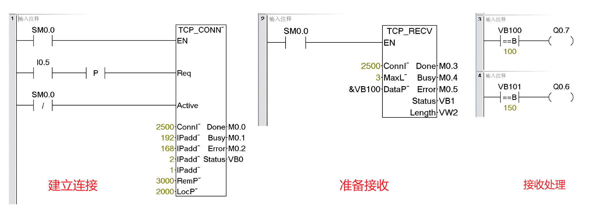

> 参数说明
>
> - TCP_CONNECT
>   - Active：作为接收端，此为被动连接；
>   - ConnID：连接 ID 范围为 0 到 65534；
>   - IPaddr1 ~4：192.168.2.1（发送端IP地址）
>   - RemPort：**对应发送设备**上的本地端口号
>   - LocPort：本地设备上的端口号，范围为 1 到 49151（**对应发送端的远程端口号）**
> - TCP_RECV 
>   - ConnID：与建立连接的标识相同；
>   - MaxLen：要接收的最大字节数（1 到 1024）。
>   - DataPtr：指向接收数据存储位置的指针（例如，＆VB100）；
>   - Length：实际接收的字节数；
> - 处理数据
>   - 当接收到100/150的时候，线圈得电；

> 易错点：
>
> IP地址、端口号、Active、存储器的设置；

### 网口线直连

> 使用同一根网线连接两个PLC设备；

## 通信选型建议

| 特性          | GET/PUT             | PROFINET               | TCP              |
| :------------ | :------------------ | :--------------------- | :--------------- |
| **协议归属**  | 西门子专用          | PROFINET 国际标准      | 通用标准 TCP/IP  |
| **通信模型**  | 单边（主站编程）    | 主从（IO 控制器/设备） | 双边（双方编程） |
| **实时性**    | 一般（非实时）      | **高（实时）**         | 一般（非实时）   |
| **典型用途**  | 西门子 PLC 间传数据 | 控制远程 I/O、驱动器   | 对接第三方设备   |
| **编程/组态** | 调用 GET/PUT 指令   | 导入 GSD 文件并组态    | 调用 OUC 指令库  |

**选型口诀**：**全是西门子传数据，用 GET/PUT；控制远程硬件，用 PROFINET；对接第三方设备，用 TCP。**