## GET/PUT 通信

> 1200 的S7通信可以使用仿真模拟；通过直接创建两个虚拟的PLC进行通讯；

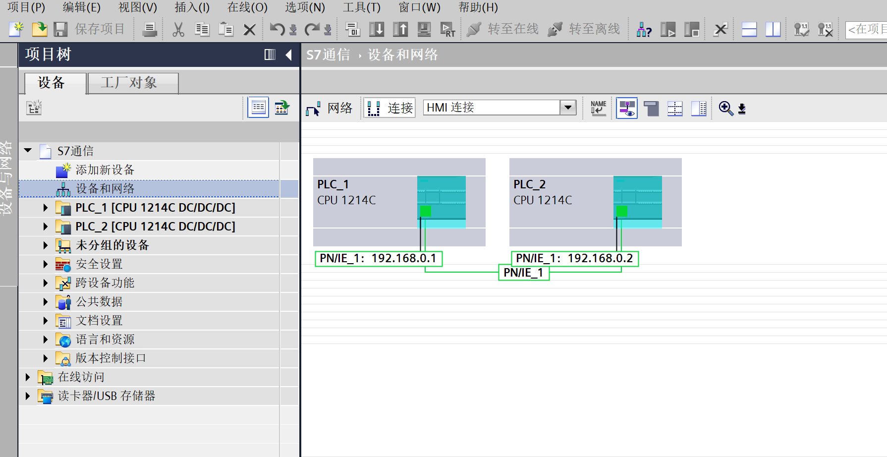

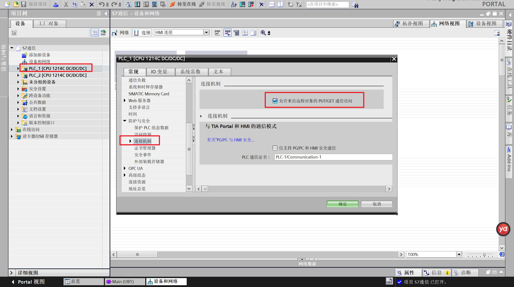

> 注意事项：
>
> 1. 两台PLC的`IP`地址不能相同；
> 2. 可以手动拖拽网口到另外一个PLC的网口进行连接；
> 3. 修改连接方式位 `S7连接`；
> 4. 分别修改 两台 PLC的属性中的连接机制，勾选`允许来自远程对象的PUT/GET通信访问`；
> 5. 在离线模式下进行操作;

### `PLC1`主设备

> 在主设备中写GET/PUT程序指令；**指令 -> 通信 -> S7 通信**

#### 组态

在拖出来的指令中点击 开始组态 按钮，然后在弹出的组态页面进行组态；选择伙伴 PLC 后，左侧 出现绿色 对勾表示组态成功；此时指令中的 ID 会自动填充；

**GET/PUT 指令都需要组态**；

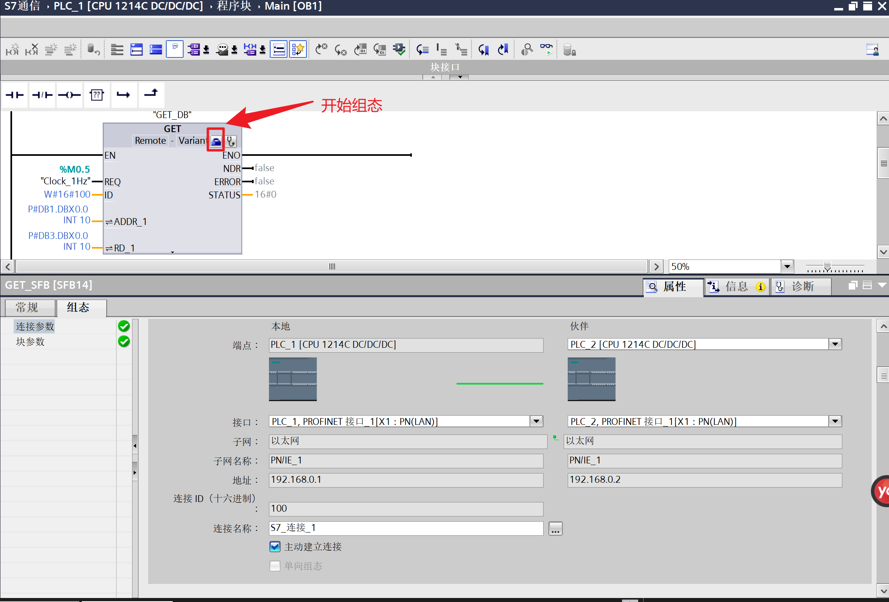

#### 数据块

通信需要存储区，所以需要新建一个数据块用于存储传输的数据；

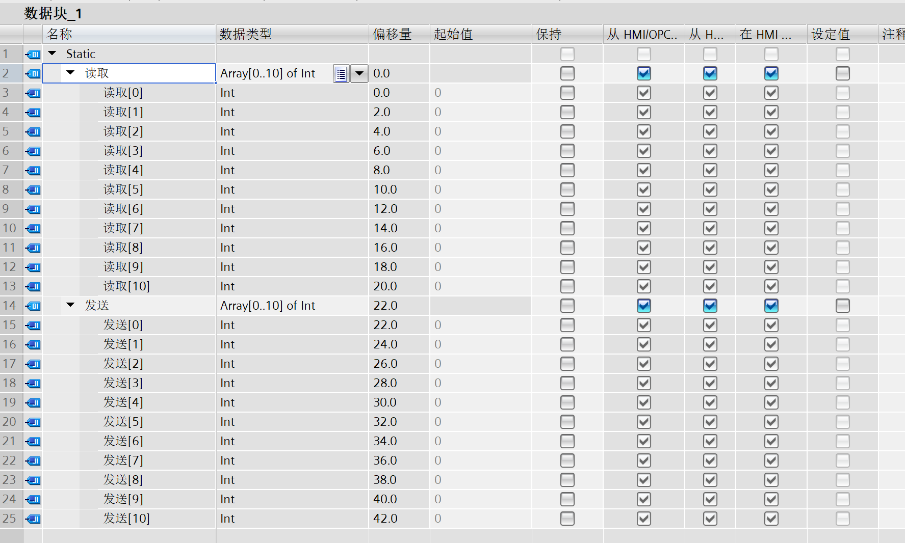

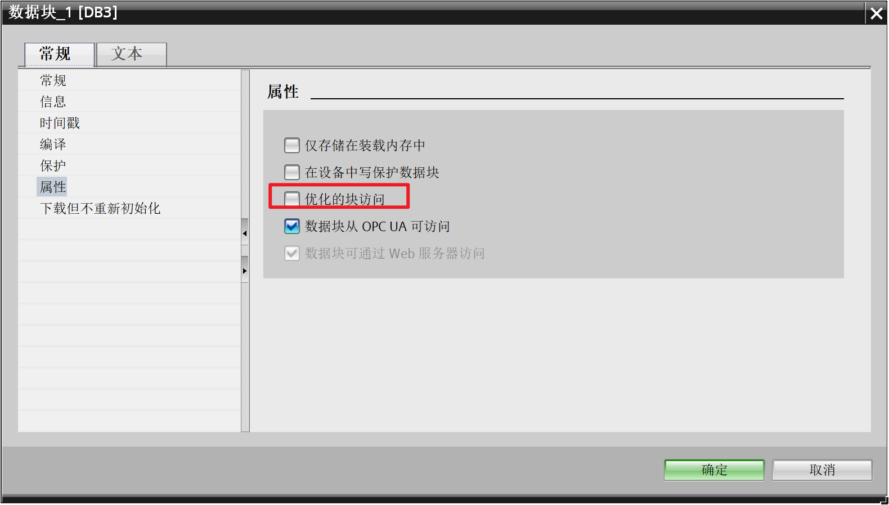

> - 数据块的属性中取消**优化块访问**；
> - 点击编译后，数据块就会出现偏移量，也就是数据的实际存储地址；
> - 两个PLC数据块都需要操作；

#### 参数说明

- GET
  - REQ：控制参数 request，在上升沿时激活数据交换功能；
    - **可以使用 系统时钟存储器 `M0.5`来控制，但是需要在属性中启用时钟存储器字节；**
  - ID：指定与伙伴 CPU 连接的寻址参数；
  - ADDR_1：指向伙伴 CPU 上**待读取区域**的指针；
    - 示例：P#DB10.DBX5.0 字节 10。
  - RD_1：指向本地读取数据的区域的指针；
- PUT
  - REQ：控制参数 request，在上升沿时激活数据交换功能；
  - ID：指定与伙伴 CPU 连接的寻址参数；
  - ADDR_1：指向伙伴用于**写入数据**的区域的指针。
  - SD_1：指向本地要发送数据的区域的指针。

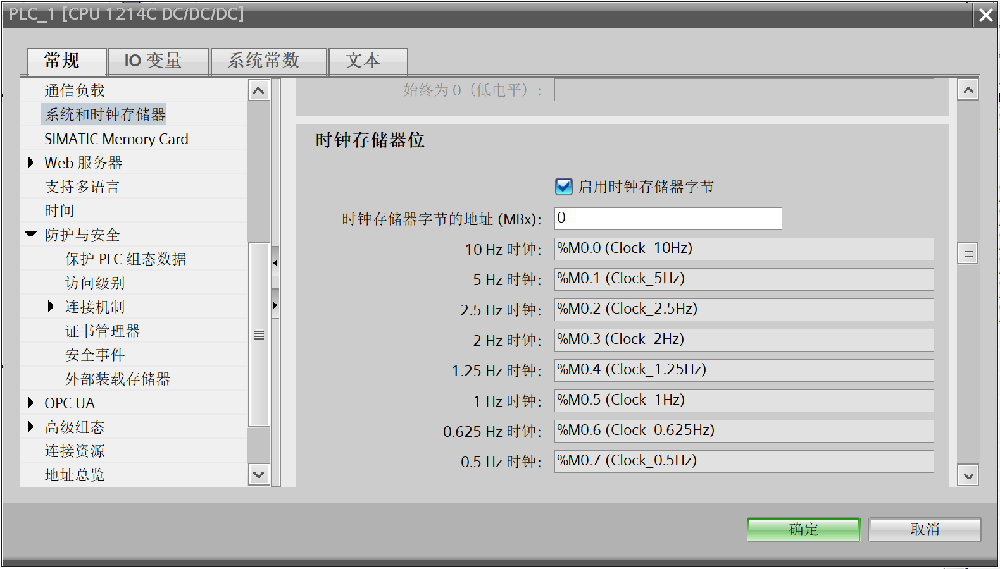

#### 参数填写

- GET
  - REQ：`M0.5`;
  - ID：系统自动生成
  - ADDR_1：`P#DB1.DBX0.0 INT 10`
  - RD_1：`P#DB3.DBX0.0 INT 10`
- PUT
  - REQ：`M0.5`;
  - ID：系统自动生成
  - ADDR_1：`P#DB1.DBX22.0 INT 10`
  - RD_1：`P#DB3.DBX22.0 INT 10`

> P#DB3.DBX22.0 INT 10
>
> - P#：固定写法；
> - DB3：自己创建的数据块的编号；
> - DBX22.0：偏移量；
> - INT：数据类型，字节；
> - 10：存储区的个数；

#### 程序

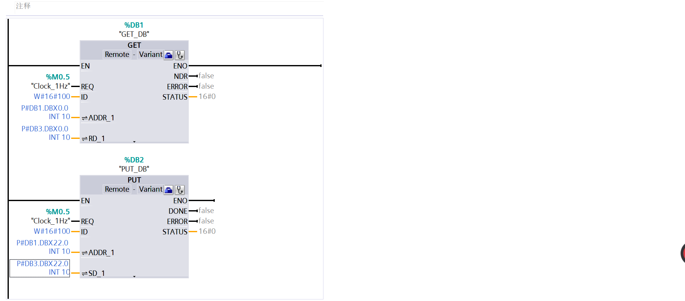

### `PLC2`从设备

> 从设备不需要写程序，也不需要组态，只需要创建一个用于存储的数据块就行了；

#### 数据块

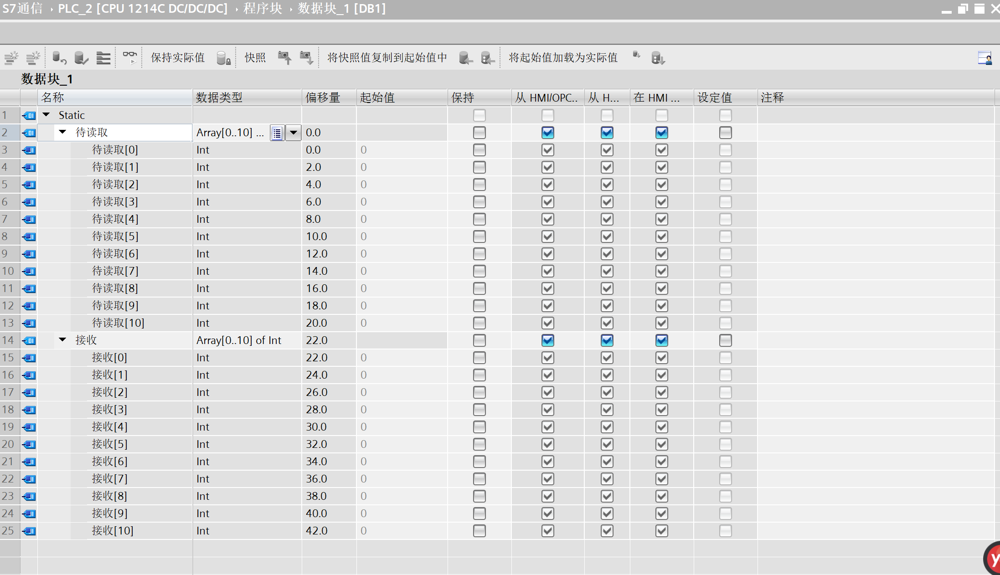

### 仿真

1. PLC_1：直接点击仿真；
   - 连接并下载到仿真设备；
   - 在仿真界面，新建一个 仿真PLC，然后启动；仿真软件会自动创建一个新IP；
2. PLC_2：不需要点击仿真了，直接下载设备连接仿真中创建的第二个 PLC就行；
3. 连接成功后，仿真处于组态并运行状态；
4. 如果无法连接到仿真，重启V19软件；

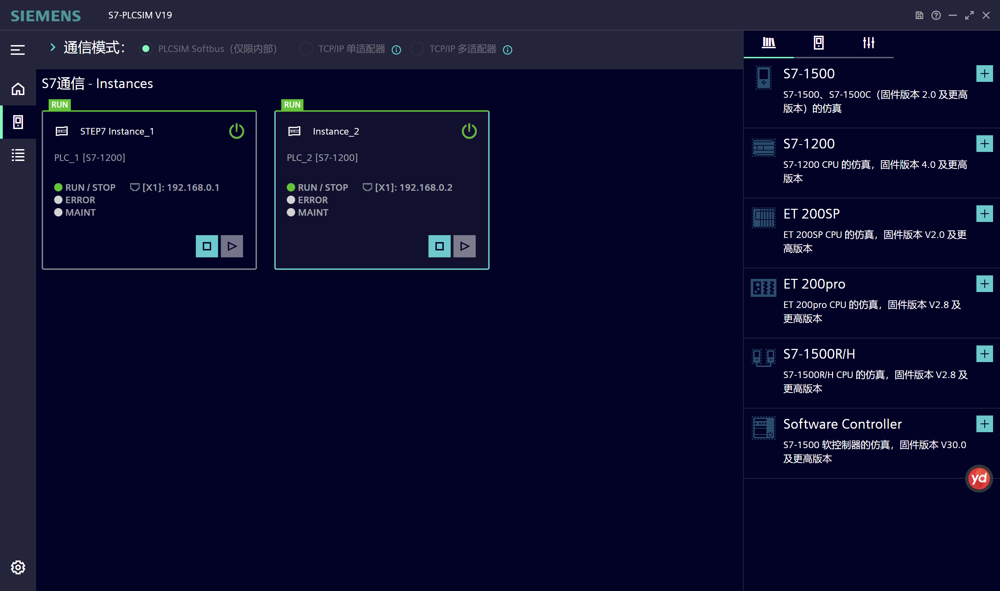

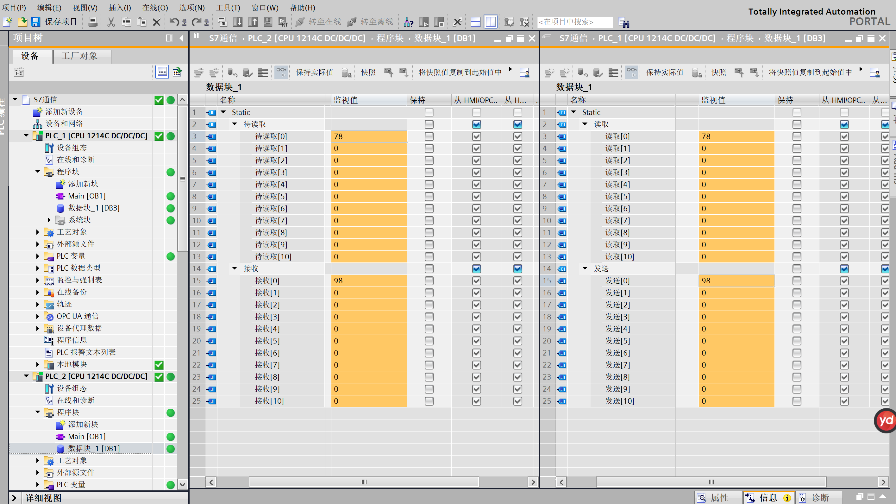

## PROFIENT 通信

> - 同时创建三个 PLC ，并配置网络连接；
> - 修改2/3plc的属性，在`PROFINET 接口[X1]`中勾选**IO设备**，并选择上一级的设备；
>   - 此时 设备和网络 中显示的 PLC 会出现上一级的 plc 标识；
> - 配置伙伴的传输区；
> - 进行通信；

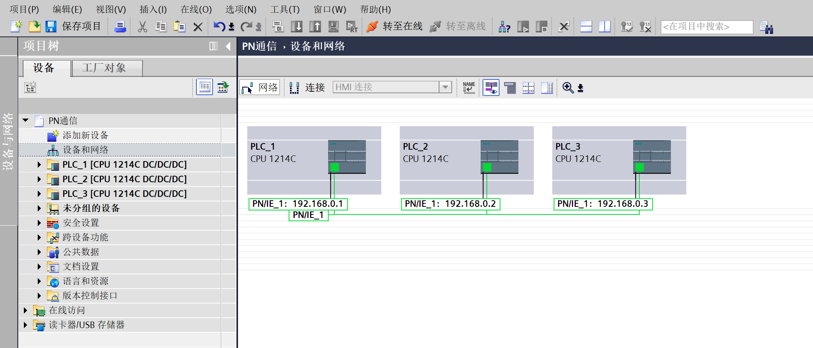

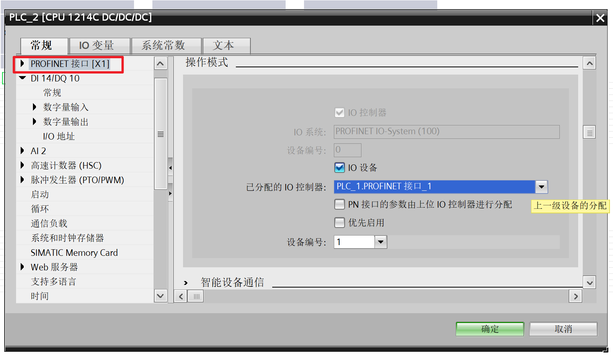

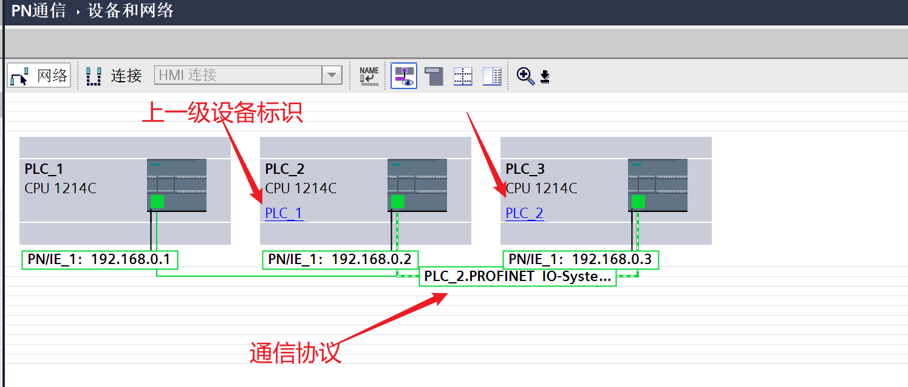

### PLC_1

> 不需要任何配置，直接下载到设备就可以了；

### PLC_2

#### 配置传输区

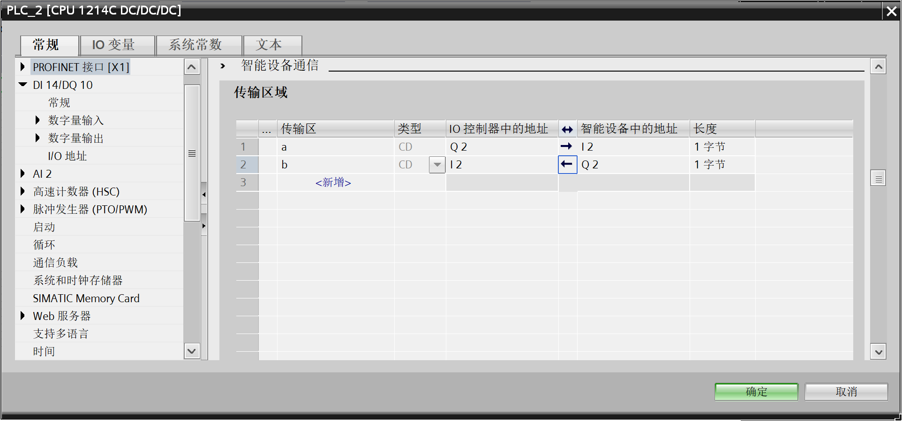

#### 下载到设备

> 连接实物 PLC2并下载到设备中；

#### 添加监控

> 在`PLC_1`和`PLC_2`中分别添加监控；

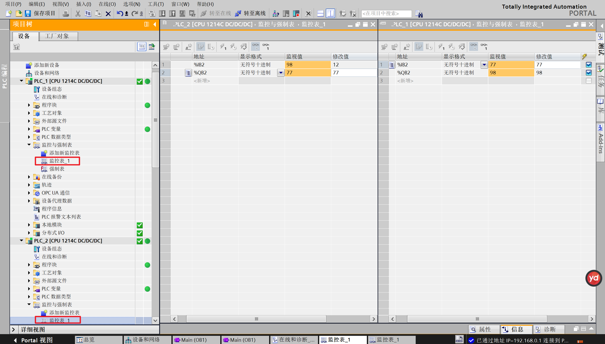

### 调试

1. 两台PLC都处于运行状态；
2. 打开监控表并启用监听；
3. 在**修改值**处填写数字，然后点击立即修改；
4. 伙伴 PLC 中的IB会接收到信息；
5. 注意：QB发送 IB接收，需要在 QB 中修改；

### 注意事项

1. 固件版本不同，创建的PLC固件版本与实物PLC固件版本不一致；
   - 方案一：修改组态的PLC固件版本与实物固件版本保持一致；
   - 方案二：在线与诊断中恢复出厂设置；
   - 方案三：重启软件，重新下载到设备；
2. 模块存在，下位组件出错；
   - 方案一：伙伴的硬件配置下载到设备并验证结果；
   - 方案二：伙伴的PLC恢复出厂设置后下载硬件配置后并验证结果；
   - 方案三：两台PLC都恢复出厂设置后下载硬件配置并验证结果；
   - 方案四：重启软件，重新下载到设备；

## TCP 通信

### 网络连接

创建2个PLC并进行拖拽连接，连接方式选择`TCP连接`；

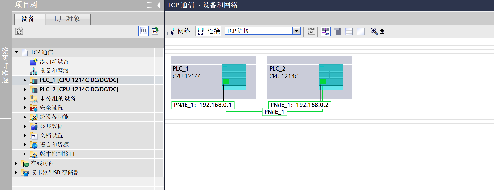

### 指令配置

> 指令位置：指令 -> 通信 -> 其它 -> MODBUS TCP；
>
> - `MB_CLIENT`：作为`Modbus TCP`客户端，该指令在客户端和服务器之间建立连接，发送请求并接收响应；
> - `MB_SERVER`：作为`Modbus TCP`服务器，该指令处理 `Modbus TCP` 客户端的连接请求、接收来自`Modbus`功能的请求并发送响应；

#### MB_CLIENT

参数说明：

- REQ：
- DISCONNECT：可以控制与 Modbus 服务器建立和终止连接
  - 0：建立通信连接
  - 1：断开通信连接
- MB_MODE：选择 Modbus 的请求模式（0：读取；1/2：写入）
- MB_DATA_ADDR：取决于 MB_MODE
- MB_DATA_LEN：数据长度：数据访问的位数或字数
- MB_DATA_PTR：指向待从 Modbus 服务器接收的数据或待发送到 Modbus 服务器的数据所在数据缓冲区的指针。
- CONNECT：指向连接描述结构的指针

#### MB_SERVER

参数说明：

- DISCONNECT
- [MB_HOLD_REG](53718784907.htm) 
- [CONNECT](53718924683.htm) 
- NDR
- DR